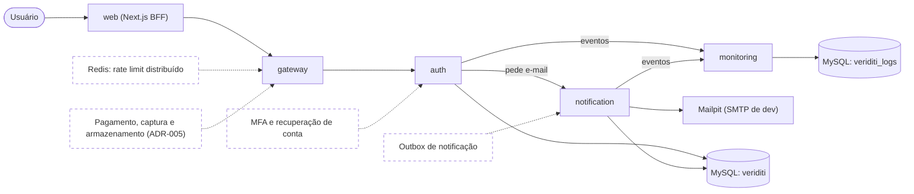

# Veriditi
[](https://github.com/Jaedsonn/Veredict/actions/workflows/ci.yml?query=branch%3Amain)

O Veriditi é uma plataforma de captura e preservação de provas digitais, construída em
**Arquitetura Baseada em Serviços** ([ADR-005](docs/adr/0005-arquitetura-baseada-em-servicos.md)):
uma web Next.js (BFF) fala com um único gateway, que valida o JWT e repassa as chamadas aos serviços de
autenticação, notificação e monitoramento, com bancos separados por serviço no MySQL. A Sprint 1
entrega cadastro com verificação de e-mail, login, perfil e trilha de auditoria; o restante do
escopo está em [`docs/requisitos.md`](docs/requisitos.md).



Linhas tracejadas são a Sprint 2, ainda não implementadas. As chamadas entre serviços são HTTP
internas com `X-Internal-Token`, sem passar pelo gateway
([ADR-016](docs/adr/0016-comunicacao-interna-http-fire-and-forget.md)); `auth` e `notification` usam o banco
`veriditi` (cada um com seu usuário e suas tabelas), e só o `monitoring` escreve em `veriditi_logs`.

```
veriditi/
├── apps/
│   └── web/                  # Next.js 16 (App Router, TS, Tailwind)
├── services/
│   ├── gateway/              # API Gateway (sem banco), único backend com porta pública
│   ├── auth/                 # Autenticação (banco veriditi)
│   │   ├── src/auth_service/
│   │   ├── migrations/       # Alembic do serviço (alembic_version_auth)
│   │   ├── tests/
│   │   └── Dockerfile
│   ├── notification/         # Notificações por e-mail (banco veriditi)
│   └── monitoring/           # Trilha de auditoria (banco veriditi_logs)
├── libs/
│   └── python/common/        # Infra compartilhada: settings, conexão, tipos, health
├── docker/mysql/init/        # Bancos e usuários MySQL (só rodam com o volume vazio)
├── packages/                 # (futuro) pacotes TS compartilhados
├── docker-compose.yml
├── Makefile
├── package.json              # npm workspaces
└── pyproject.toml            # uv workspace (um único uv.lock)
```

## Documentação

| Documento | Conteúdo |
| --------- | -------- |
| [Requisitos e escopo](docs/requisitos.md) | RF01–RF21, RNF01–RNF08, escopo da Sprint 1 (30%) e rastreabilidade |
| [ADRs](docs/adr/README.md) | Decisões de arquitetura e desvios em relação ao documento original |
| [Banco de dados](docs/banco-de-dados.md) | Modelo de dados, posse por serviço e privilégios |
| [SOLID e arquitetura](docs/solid.md) | Onde e por que cada princípio SOLID foi aplicado, com links para o código |
| [Uso de IA](docs/uso-de-ia.md) | Declaração do autor sobre as ferramentas de IA usadas |

Sistema publicado: **pendente** (entrega via VM no #17).

## Pré-requisitos

Node 22+, [uv](https://docs.astral.sh/uv/), Docker com Compose.

## Setup

```bash
make install   # npm install + uv sync + cria .env + par RS256 de dev (make keys)
make up        # sobe mysql + migrations + serviços + web
```

O auth assina o access token com `JWT_PRIVATE_KEY` e o gateway valida com
`JWT_PUBLIC_KEY`; **o gateway não sobe sem a chave pública**. Quem já tinha
`.env` roda `make keys`, que grava o par no `.env` sem imprimir a chave e não
mexe num par já existente. `make keys force=1` troca o par: reinicie auth e
gateway, e as sessões abertas caem.

O `.env.example` fica só com `JWT_PRIVATE_KEY=` e `JWT_PUBLIC_KEY=` vazios. Um
par preenchido ali seria copiado para todo `.env` novo, o `make keys`
responderia "já existem" e todo ambiente passaria a usar uma chave privada
conhecida, que assina token válido para qualquer usuário.

| O quê                     | URL                                |
| ------------------------- | ---------------------------------- |
| Web                       | http://localhost:3000              |
| Health agregado (web)     | http://localhost:3000/api/health   |
| Gateway (só `/api/*` e `/health/*`) | http://127.0.0.1:8080/health/ready |
| Mailpit (e-mails de dev)  | http://localhost:8025              |
| Mailpit SMTP              | localhost:1025 (`MAILPIT_SMTP_PORT`) |
| MySQL (host)              | localhost:3307                     |

O gateway **não expõe `/docs`, `/redoc` nem `/openapi.json`**
([ADR-018](docs/adr/0018-api-gateway-como-servico-fastapi.md)): a documentação das rotas é a tabela
de [API Gateway](#api-gateway). O `/docs` de cada serviço interno existe só na rede do compose.

As portas do host vêm do `.env` (`WEB_PORT`, `GATEWAY_PORT`, `MAILPIT_UI_PORT`,
`MAILPIT_SMTP_PORT`, `DB_PORT`). `auth`, `notification` e `monitoring` não
publicam porta: só o gateway e a web são acessíveis de fora da rede do compose.
Em dev, todas as portas publicadas (MySQL, Mailpit, gateway e web) ficam presas a
`127.0.0.1`. Para web e gateway isso é requisito de segurança: o gateway confia no
`X-Forwarded-For` que a web repassa, e o Next só preenche esse header quando ele
não veio, então uma web exposta na LAN deixaria qualquer máquina forjar o IP
usado no rate limit e no `actor_ip` (veja [API Gateway](#api-gateway)). O SMTP do Mailpit também é
publicado, por decisão consciente: sem ele o `make dev s=notification` fora do
Docker não teria onde entregar e-mail. Ao mudar o `MAILPIT_SMTP_PORT`, mude
também o `SMTP_PORT` do `.env`, que é a porta usada pelo notification fora do
Docker. Dentro do compose o notification usa sempre `mailpit:1025`.

## Demonstração

Com `make up` rodando (web em http://localhost:3000, Mailpit em http://localhost:8025, gateway em
http://127.0.0.1:8080):

1. Abra http://localhost:3000/cadastro e crie uma conta (senha com 10+ caracteres, letra e número).
2. Abra o Mailpit em http://localhost:8025 e copie o código de 6 dígitos do e-mail de verificação.
3. Informe o código em http://localhost:3000/verificar-email.
4. Entre em http://localhost:3000/entrar com o e-mail e a senha.
5. Em http://localhost:3000/perfil, edite o nome e salve.
6. Num terminal, rode `make audit-tail`: aparecem `auth.user.registered`, `notification.email.sent`
   e os demais eventos do fluxo (Ctrl-C para sair; `n=30` mostra mais histórico).

## Variáveis de ambiente

Todas vêm do `.env`, criado pelo `make install` a partir do `.env.example`, que traz os
comentários completos e as regras de formato. Esta tabela é o índice:

| Variável | Para quê | Detalhes |
| -------- | -------- | -------- |
| `MYSQL_ROOT_PASSWORD` | Senha do root, só no initdb do MySQL | [Banco](#banco) |
| `DB_MIGRATOR_PASSWORD` | Senha do `migrator`, que faz o DDL | [Banco](#banco) |
| `AUTH_DB_PASSWORD` | Senha do usuário de runtime do auth | [Banco](#banco) |
| `NOTIFICATION_DB_PASSWORD` | Senha do usuário de runtime do notification | [Banco](#banco) |
| `LOGS_DB_PASSWORD` | Senha do `veriditi_logs_writer`, do monitoring | [Banco](#banco) |
| `DB_HOST` | Host do MySQL no `make dev`/`migrate`; no compose é `mysql` | [Hot reload](#desenvolvimento-com-hot-reload) |
| `DB_PORT` | Porta do MySQL publicada no host (3307) | [Hot reload](#desenvolvimento-com-hot-reload) |
| `MONITORING_URL` | URL do monitoring no `make dev` | [Logs](#logs-e-x-request-id) |
| `NOTIFICATION_URL` | URL do notification no `make dev` | [Logs](#logs-e-x-request-id) |
| `INTERNAL_API_TOKEN` | Token das chamadas internas (mínimo de 16 caracteres) | [Logs](#logs-e-x-request-id) |
| `LOG_LEVEL` | Nível dos logs JSON | [Logs](#logs-e-x-request-id) |
| `JWT_PRIVATE_KEY` | Chave privada RS256 do auth, gerada por `make keys` | [Setup](#setup) |
| `JWT_PUBLIC_KEY` | Chave pública RS256 do gateway, gerada por `make keys` | [Setup](#setup) |
| `JWT_ISSUER` | Claim `iss`, igual no auth e no gateway | [API Gateway](#api-gateway) |
| `JWT_AUDIENCE` | Claim `aud`, igual no auth e no gateway | [API Gateway](#api-gateway) |
| `TRUSTED_PROXIES` | Proxies cujo `X-Forwarded-For` o gateway aceita | [API Gateway](#api-gateway) |
| `VERIFICATION_PEPPER` | Pepper do HMAC dos códigos de verificação (mínimo de 16 caracteres) | [`docs/solid.md`](docs/solid.md) |
| `SMTP_HOST` | Servidor SMTP do notification fora do Docker | [Notificações](#notificações-por-e-mail) |
| `SMTP_PORT` | Porta SMTP fora do Docker | [Notificações](#notificações-por-e-mail) |
| `SMTP_USER` | Usuário SMTP, vazio no Mailpit | [Notificações](#notificações-por-e-mail) |
| `SMTP_PASSWORD` | Senha SMTP, vazia no Mailpit | [Notificações](#notificações-por-e-mail) |
| `SMTP_FROM` | Remetente dos e-mails | [Notificações](#notificações-por-e-mail) |
| `SMTP_STARTTLS` | STARTTLS, para provedor na porta 587 | [Notificações](#notificações-por-e-mail) |
| `SMTP_USE_TLS` | TLS implícito, para provedor na porta 465 | [Notificações](#notificações-por-e-mail) |
| `SMTP_TIMEOUT_SECONDS` | Timeout de cada tentativa de envio | [Notificações](#notificações-por-e-mail) |
| `WEB_URL` | Base dos links dos e-mails e origem do CORS | [Notificações](#notificações-por-e-mail) |
| `GATEWAY_URL` | URL do gateway para a web fora do Docker | [Web sem o backend](#web-sem-o-backend-gateway-mock) |
| `WEB_PORT` | Porta da web no host (3000) | [Setup](#setup) |
| `GATEWAY_PORT` | Porta do gateway no host (8080) | [Setup](#setup) |
| `MAILPIT_UI_PORT` | Porta da UI do Mailpit no host (8025) | [Setup](#setup) |
| `MAILPIT_SMTP_PORT` | Porta SMTP do Mailpit no host (1025) | [Setup](#setup) |

## Operação e referência

### Banco

Os scripts de `docker/mysql/init` (bancos `veriditi` e `veriditi_logs`,
usuário `migrator` e um usuário de runtime por serviço) **só rodam com o volume
vazio**. Ao atualizar para esta versão, ou ao mudar o init:

1. Atualize o `.env` a partir do `.env.example`. As senhas agora são por
   usuário (`DB_MIGRATOR_PASSWORD`, `AUTH_DB_PASSWORD`,
   `NOTIFICATION_DB_PASSWORD`, `LOGS_DB_PASSWORD`), e o compose recusa subir
   sem elas. Quem não tinha `.env` pode rodar `make install`.
2. Recrie o volume e suba de novo:

   ```bash
   make reset     # docker compose down -v --remove-orphans
   make up
   ```

`make down`, `make reset` e `make logs` funcionam mesmo com o `.env` antigo
(o `.env.example` preenche só as senhas que faltam), para dar para derrubar o
stack anterior.

As imagens se chamam `veriditi-<serviço>` em qualquer projeto do compose: dois
clones lado a lado (`COMPOSE_PROJECT_NAME` diferente) compartilham a tag, e o
último build vence.

Se o `mysql` ficar `unhealthy` logo na primeira subida, o init falhou (veja
`make logs`, geralmente senha faltando ou com `'`/`\`): corrija o `.env` e rode
`make reset`, porque o init não roda de novo sobre um volume já criado.

O modelo de dados está em [`docs/banco-de-dados.md`](docs/banco-de-dados.md).

### Desenvolvimento com hot reload

```bash
make db                          # só o MySQL no Docker
make migrate                     # migrations de todos os serviços (ou s=auth)
make dev s=auth                  # terminal 1 (s=gateway|auth|notification|monitoring)
make dev-web                     # terminal 2
make migration s=auth m="msg"    # nova revisão autogerada
make test                        # testes sem MySQL (ou s=auth)
make cov                         # testes com cobertura mínima de 70% (ou s=auth|common)
make db-test                     # contrato + migrations num MySQL descartável (porta 3317)
```

| Serviço      | `make dev` |
| ------------ | ---------- |
| gateway      | 8080       |
| auth         | 8001       |
| notification | 8002       |
| monitoring   | 8003       |

`make help` lista todos os comandos.

### Testes

| Camada | O que prova | Onde | Local | CI |
| --- | --- | --- | --- | --- |
| Unitário | Casos de uso e adaptadores com fakes em memória | `services/<s>/tests/test_*.py` | `make test` | `tests (<s>)` |
| API | Rotas pela fixture `client` (`httpx.AsyncClient` + `ASGITransport`), sem rede | Testes que pedem `client`: `test_health.py` (auth), `test_proxy_api.py` e `test_cors.py` (gateway), `test_notifications_api.py` (notification), `test_events_api.py` (monitoring) | `make test` | `tests (<s>)` |
| Contrato | Rotas do gateway existem no OpenAPI do auth | `services/auth/tests/test_gateway_contract.py` | `make test s=auth` | `tests (auth)` |
| MySQL real | Privilégios (1142/1044), DDL físico, UTC e migrations | `tests/mysql/` (marcador `mysql`) | `make db-test` | `database` |

`make cov` roda o mesmo comando da matriz `tests` do CI e falha abaixo de 70% (linhas e desvios) em cada serviço e na lib comum (`s=common`). Os testes `mysql` não entram na medição: rodam no job `database`. O `UPDATE` e o `DELETE` negados em `audit_events` são provados por `test_writer_can_only_append`, em `services/monitoring/tests/mysql/`. O teste de contrato roda sempre: toda rota do gateway com upstream `auth` precisa existir no OpenAPI do auth.

### Logs e X-Request-ID

Os serviços escrevem uma linha JSON por evento no stdout, inclusive as do
uvicorn ([ADR-012](docs/adr/0012-geracao-de-logs-estruturados.md)):

```json
{"route": "/api/me", "upstream": "auth", "user_id": 42, "method": "GET", "path": "/api/me", "status_code": 200, "duration_ms": 4.12, "event": "request_finished", "request_id": "3f2b8c1e-8a4e-4a39-9a2b-1f1e0c9d7a55", "level": "info", "logger": "veriditi_common.middleware", "service": "gateway", "timestamp": "2026-11-12T05:26:22.960365Z"}
```

Toda resposta traz o `X-Request-ID`. O gateway sempre gera um UUID4 novo e
ignora o do cliente (`RequestContextMiddleware(trust_request_id=False)`); os
serviços internos aceitam o que o gateway manda, se for um UUID válido, e só
geram um quando ele falta. `route`, `upstream` e `user_id` entram no log de
acesso do gateway por `set_log_fields`. Para seguir uma requisição, `make logs | grep <request_id>`. O
acesso a `/health/*` só aparece com `LOG_LEVEL=DEBUG`.

A redação troca por `[redacted]` o valor de chaves sensíveis, em qualquer
nível do evento (`is_sensitive_key` em `veriditi_common/logging.py`):

- o nome é normalizado: camelCase, acentos, `-`, `.`, `:`, `/`, espaço e `2FA`
  (`apiKey`, `X-Api-Key`, `auth.code`, `código` e `2FACode` viram `api_key`, `x_api_key`,
  `auth_code`, `codigo` e `2fa_code`);
- é sensível o nome que contém `password`, `passphrase`, `secret`, `token`,
  `authorization`, `cookie`, `credential`, `signature`, `private_key`,
  `api_key`, `access_key`, `signing_key`, `encryption_key`, `session_key`,
  `database_url`, `otpauth` ou `passcode`, ou que tem um segmento `otp`, `pin`, `pwd`, `senha`,
  `jwt`, `dsn`, `hmac`, `seed` e afins;
- `code`, `codes`, `codigo` e `codigos` sozinhos são sensíveis; com mais segmentos, só
  quando o segmento logo antes é prefixo de segredo (`verification_code`,
  `recovery_codes`, `one_time_code`...) ou, em português, quando o logo depois é um
  qualificador (`codigo_verificacao`). `status_code`, `email_error_code`, `zip_code` e
  `codigo_postal` não são: por isso o código de erro de negócio vai em `error_code`;
- metadados do segredo não são redigidos (`token_type`, `token_id`,
  `password_changed_at`, `has_password`...);
- pares `(nome, valor)` são tratados como headers quando o nome é bytes ou a
  chave pai contém `header`.

Nas exceções, tipo e frames sempre saem. A mensagem só é redigida em erros de
banco (que ganham `db_errno`, como 1062) e em `ValidationError`. A redação é por
nome de chave: não logue `str(exc)` nem interpole valores no evento.

Os erros seguem `{"detail": {"code": "...", "message": "...", ...extras}}`, o
formato lido por `apps/web/src/lib/errors.ts`; o 422 de validação mantém o
formato do FastAPI (`loc`, `msg` e `type`), sem `input` nem `ctx`, que repetiriam a
entrada. Falhas de entrega ao monitoring e ao notification não
quebram a requisição: aparecem no log com `audit_fallback=true` e
`notification_fallback=true`.

| Variável | Uso |
| -------- | --- |
| `LOG_LEVEL` | `DEBUG`, `INFO` (padrão), `WARNING` ou `ERROR` |
| `INTERNAL_API_TOKEN` | Mínimo de 16 caracteres; gateway, auth, notification e monitoring não sobem sem ele |
| `MONITORING_URL`, `NOTIFICATION_URL` | Só no `make dev`; o compose fixa `http://monitoring:8000` e `http://notification:8000` |

### Trilha de auditoria

O monitoring grava os eventos do `HttpAuditLogger` em `veriditi_logs.audit_events`,
append-only: o `veriditi_logs_writer` só tem `SELECT` e `INSERT`
([ADR-015](docs/adr/0015-log-storage-em-database-mysql-separada.md)). As rotas são
internas, exigem `X-Internal-Token` e não passam pelo gateway:

- `POST /internal/events` responde `202 {"status":"accepted"}`, inclusive no reenvio
  do mesmo `event_id`, que não duplica;
- o corpo vai até 64 KiB (acima, `413 payload_too_large`) e o `metadata` até 16 KiB em
  JSON e 8 níveis de aninhamento (acima, 422; com uns 10 mil níveis o `json.loads` desiste
  antes e a resposta é `400 http_error`);
- `GET /internal/events` filtra por `actor_id`, `action` e `[from, to)` e pagina por
  `after_id` (`limit` até 200, `next_cursor` nulo na última página). No fuso, use `Z` ou
  `%2B00:00`: um `+` cru na URL vira espaço e dá 422. O cursor pagina eventos já
  gravados; não use `after_id` para acompanhar a cauda, porque um `id` menor pode ser
  confirmado depois de um maior.

Para acompanhar os eventos em tempo real, `make audit-tail` (`n=<qtd>` define quantos eventos
do histórico aparecem primeiro; Ctrl-C sai). Ele consulta o monitoring de 2 em 2 segundos
por `from=` e imprime só `event_id` novos; um evento com `occurred_at` mais de 2 min atrás, ou além de 200 por janela, não aparece na cauda (só no histórico inicial). Para uma consulta pontual com filtros:

```bash
docker compose exec monitoring python -c "import os, urllib.request as u; r = u.Request('http://127.0.0.1:8000/internal/events?actor_id=42&from=2026-11-12T00:00:00Z&limit=20', headers={'X-Internal-Token': os.environ['INTERNAL_API_TOKEN']}); print(u.urlopen(r).read().decode())"
```

O `metadata` passa pela mesma redação dos logs antes de ser gravado: o valor de chave
sensível vira `[redacted]` e a chave fica. A redação é por nome de chave, então o
produtor não deve pôr segredo no valor de chaves neutras (`note`, `detail`).

### Notificações por e-mail

O notification envia os e-mails transacionais (RF11) a partir de pedidos dos outros
serviços, feitos com o `HttpNotifier` da lib. A rota é interna, exige
`X-Internal-Token` e não passa pelo gateway:

```http
POST /internal/notifications
{"idempotency_key": "email_verification:42", "template": "email_verification",
 "to": "joao@exemplo.com", "data": {"name": "João", "code": "042137", "expires_in_minutes": 15}}
```

- `202 {"status":"accepted"}` sai logo depois de reservar a chave em
  `veriditi.notifications_sent`; o SMTP roda depois da resposta. A resposta é a
  mesma para uma chave repetida, que **não** reenvia, esteja ela `sent`, `pending` (em
  andamento) ou `failed` (terminal na Sprint 1; o reenvio do código no auth gera uma
  chave nova);
- template desconhecido ou `data` inválido dão 422 no formato de validação do FastAPI
  (`unknown_template` traz a lista dos válidos no `msg`), sem ecoar o valor recebido;
  corpo acima de 16 KiB dá `413 payload_too_large`;
- no máximo 3 tentativas, com esperas de 1 s e 2 s; um 5xx do SMTP (destinatário
  recusado, credencial errada), um servidor sem STARTTLS ou SMTPUTF8 e um certificado
  inválido encerram na hora. O fim vira `notification.email.sent`
  ou `notification.email.failed` no monitoring, só com o template, o e-mail mascarado
  (`j***@exemplo.com`), a chave, o `message_id` ou o erro, sem o conteúdo.

Templates disponíveis: `email_verification` (`name`, `code` com 6 dígitos em texto,
`expires_in_minutes`) e `welcome` (`name`). O `name` é obrigatório, mas não é recusado
pelo conteúdo: quebras de linha e caracteres de controle viram espaço, os espaços
repetidos colapsam e, se nada sobrar, a saudação vira "Olá!" em vez de 422 (que deixaria
a chave do auth sem e-mail). Só acima de 120 caracteres ele dá 422. Cada um fica em
`services/notification/src/notification_service/templates/<nome>/` com `subject.txt`,
`body.txt` e `body.html` (este estende o `_layout.html` e é escapado). Para acrescentar
um e-mail:

1. crie a pasta `templates/<nome>/` com os 3 arquivos;
2. crie o model do `data` em `catalog.py`, herdando de `TemplateData`;
3. acrescente o `TemplateSpec("<nome>", <Model>)` em `build_registry()`.

O caso de uso não muda. Um template registrado sem os 3 arquivos derruba a subida do
serviço, e um snapshot em `tests/snapshots/` fixa o corpo renderizado.

| Variável | Uso |
| -------- | --- |
| `SMTP_HOST`, `SMTP_PORT` | Só no `make dev` (padrão `localhost:1025`, o Mailpit publicado); o compose fixa `mailpit:1025` |
| `SMTP_USER`, `SMTP_PASSWORD` | Vazios no Mailpit; usuário sem senha impede a subida, e usuário sem `SMTP_USE_TLS` nem `SMTP_STARTTLS` também, exceto no SMTP local (`localhost`, `127.0.0.1`, `::1`, `mailpit`) |
| `SMTP_FROM` | Remetente, padrão `Veriditi <no-reply@veriditi.app>`; o domínio dele vai no `Message-ID` |
| `SMTP_STARTTLS` | `false` no Mailpit; `true` num provedor na porta 587 (#17) |
| `SMTP_USE_TLS` | TLS implícito, para um provedor na porta 465; excludente com o `SMTP_STARTTLS` |
| `SMTP_TIMEOUT_SECONDS` | Timeout total de cada tentativa (conexão, TLS, AUTH e envio juntos), padrão 10 (máximo 60); o `QUIT` depois da entrega tem um teto igual, fora dele. Acima de 10, suba o `stop_grace_period` do compose para pelo menos 4 × o valor + 16 s |
| `WEB_URL` | Base dos links `/verificar-email` e `/entrar` dos e-mails |

Em dev os e-mails chegam ao Mailpit, em http://localhost:8025. Para disparar um pelo
próprio container:

```bash
docker compose exec notification python -c "import json, os, urllib.request as u; r = u.Request('http://127.0.0.1:8000/internal/notifications', data=json.dumps({'idempotency_key': 'teste:welcome:1', 'template': 'welcome', 'to': 'teste@exemplo.com', 'data': {'name': 'Teste'}}).encode(), headers={'Content-Type': 'application/json', 'X-Internal-Token': os.environ['INTERNAL_API_TOKEN']}); print(u.urlopen(r).status)"
```

Troque a `idempotency_key` para enviar de novo. Um risco aceito na Sprint 1: se o
processo morrer entre a reserva e o fim do envio, a linha fica `pending` e a chave
fica bloqueada, porque o destinatário não é gravado. O `stop_grace_period: 65s` do
compose deixa o envio terminar num `docker compose stop` (pior caso de 56 s, com
4 × `SMTP_TIMEOUT_SECONDS`), e a conta e a consulta de detecção estão em
`docs/banco-de-dados.md` §5.4.

### API Gateway

Porta única da web para o backend (RF21, [ADR-018](docs/adr/0018-api-gateway-como-servico-fastapi.md)).
Para cada `/api/...`, em ordem: recusa caminho inseguro (`%`, `//`, barra final,
`.`/`..`) com 404, casa a rota na tabela (404/405), aplica o rate limit, valida o
JWT nas rotas protegidas e repassa ao upstream em streaming. `/docs` e
`/openapi.json` não existem; notification e monitoring não têm rota (404).

**Rotas** (`services/gateway/src/gateway_service/routes.py`). O gateway tira o
`/api`: `/api/me` chega ao auth como `/me`.

| Rota | Métodos | Acesso | Limite |
| ---- | ------- | ------ | ------ |
| `/api/auth/register` | POST | pública | 10 de rajada por IP, 1 a cada 6 s |
| `/api/auth/verify-email` | POST | pública | — (o auth limita a 5 tentativas por código) |
| `/api/auth/verify-email/resend` | POST | pública | 10 por IP, bucket separado do cadastro |
| `/api/auth/login` | POST | pública | 5 de rajada por IP + e-mail, 1 a cada 12 s |
| `/api/auth/refresh` | POST | pública | — |
| `/api/auth/logout` | POST | protegida | — |
| `/api/me` | GET, PATCH | protegida | — |
| `/api/me/password` | POST | protegida | — |

Uma rota nova é uma linha nova em `ROUTES` (`Route(path, upstream,
upstream_path, public=..., methods=..., rate_limit=...)`); a tabela é validada
na subida (duplicata, upstream desconhecido, caminho inseguro, método
inválido). O casamento é exato; `prefix=True` casa também `path/...` e fica
para os ids da Sprint 2. Um upstream novo entra em `Settings.upstreams` e
passa a ser agregado no `/health/ready`.

**JWT.** Só RS256 com `JWT_PUBLIC_KEY`, exigindo `exp`, `iat`, `iss`
(`JWT_ISSUER`), `aud` (`JWT_AUDIENCE`) e `sub`, com `JWT_LEEWAY_SECONDS` (10 s).
Qualquer falha dá `401 unauthorized` + `WWW-Authenticate: Bearer`; o motivo vai
só para o log `jwt_rejected`.

**Headers.** Do cliente só passam `Accept`, `Accept-Language`, `Content-Type`,
`User-Agent`, `If-*` e `Range`; o resto cai, inclusive `Authorization`, `Cookie`,
`X-Forwarded-*`, `Forwarded`, `X-Real-IP` e `X-Refresh-Token`. O gateway sempre
injeta `X-Internal-Token`, `X-Request-ID` e `X-Forwarded-For` (um único IP, o
real) e, nas rotas protegidas, `X-User-Id`, `X-User-Email` e `X-Session-Id`.
O `X-Session-Id` vem da claim `sid` (o `family_id` da sessão, que o auth emite) e
só vai quando a claim existe; o `get_current_user` do auth o lê, por exemplo para
a troca de senha encerrar as outras sessões e manter a atual. `X-User-Email` vai em UTF-8: um upstream
Starlette lê em latin-1, então quem precisar do e-mail Unicode faz
`value.encode("latin-1").decode()`.

**IP real.** O `X-Forwarded-For` só vale quando a conexão vem de um proxy em
`TRUSTED_PROXIES` (CIDRs separados por vírgula), lido da direita para a
esquerda. Vazio (padrão do `make dev`): o XFF é ignorado. No compose, o padrão
são as faixas privadas da rede do Docker, porque a web (BFF) é quem chama o
gateway e repassa o XFF que recebeu. Isso só é confiável porque, no compose, web
e gateway escutam só no loopback do host: ninguém de fora fala com eles.

Fora do Docker essa garantia não existe: o `next dev` do `make dev-web` escuta em
`0.0.0.0` e repassa o `X-Forwarded-For` do cliente. Com `TRUSTED_PROXIES=127.0.0.1`,
uma máquina da LAN chamaria `http://<host>:3000` com um XFF forjado e o gateway
adotaria esse IP. No `make dev`, deixe `TRUSTED_PROXIES` vazio (o gateway usa o IP
da conexão) ou suba a web presa ao loopback
(`npm run dev -w @veriditi/web -- -H 127.0.0.1`) antes de confiar em `127.0.0.1`.

Em
produção, a borda (Caddy, #17) precisa **sobrescrever** o `X-Forwarded-For` com
o IP da conexão, nunca anexar ao que o cliente mandou, senão o valor forjado
chega intacto ao gateway através da web. O uvicorn roda com `--no-proxy-headers`
para não decidir isso antes.

**Rate limit.** Token bucket em memória por processo (`InMemoryTokenBucket`):
uma ficha por tentativa, consumida antes de chamar o upstream; o `429
rate_limited` traz `Retry-After` em segundos. Reiniciar o gateway zera os
limites; a Sprint 2 troca por Redis atrás da mesma porta `RateLimiter`.

**Erros de upstream.** `503 upstream_unavailable` (conexão recusada, DNS,
conexão caída), `504 upstream_timeout` (`UPSTREAM_TIMEOUT_SECONDS`, 5 s) e
`502 upstream_auth_failed` quando o upstream responde `401` com
`code: "unauthorized"`. Esse código é reservado para o token interno recusado
(configuração errada, não sessão expirada); um 401 legítimo de sessão, como
uma sessão revogada, precisa de outro código (ex.: `session_revoked`) para
chegar à web sem tradução. As demais respostas do upstream passam intactas.

**CORS e corpo.** CORS só para a origem do `WEB_URL`, sem credenciais. Corpo
acima de `MAX_BODY_BYTES` (1 MiB) dá 413; o do login, acima de 16 KiB.

### Web sem o backend (gateway mock)

O gateway real só responde às rotas de auth quando o auth com os endpoints
(#7–#10) estiver no ar. Para desenvolver a web sem ele, há um mock em memória
que implementa os contratos da Sprint 1 (cadastro, verificação, login, refresh,
logout e perfil):

```bash
npm run mock:gateway   # terminal 1 — http://localhost:8080 (códigos de verificação aparecem no console)
npm run dev:web        # terminal 2 — http://localhost:3000 (usa GATEWAY_URL, padrão http://localhost:8080)
```

`MOCK_ACCESS_TTL_S=20 npm run mock:gateway` encurta o access token para testar a renovação de sessão.

O mock usa a mesma porta 8080 do gateway do compose: pare o stack (`make down`) antes de rodá-lo.
