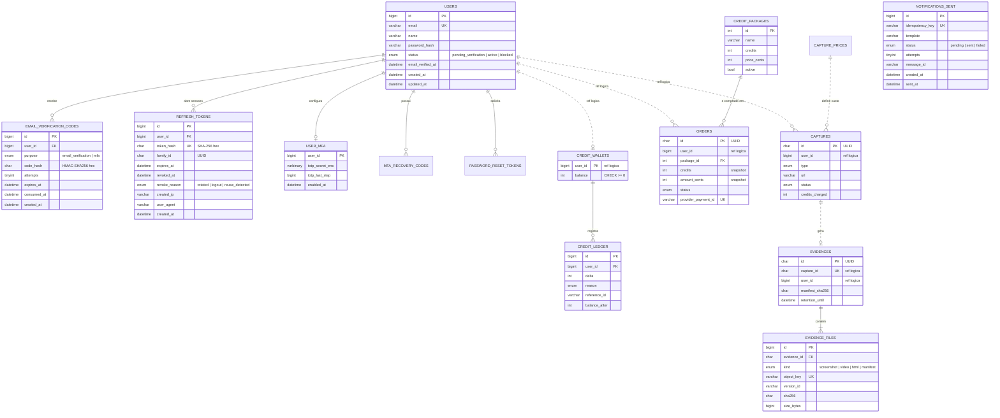
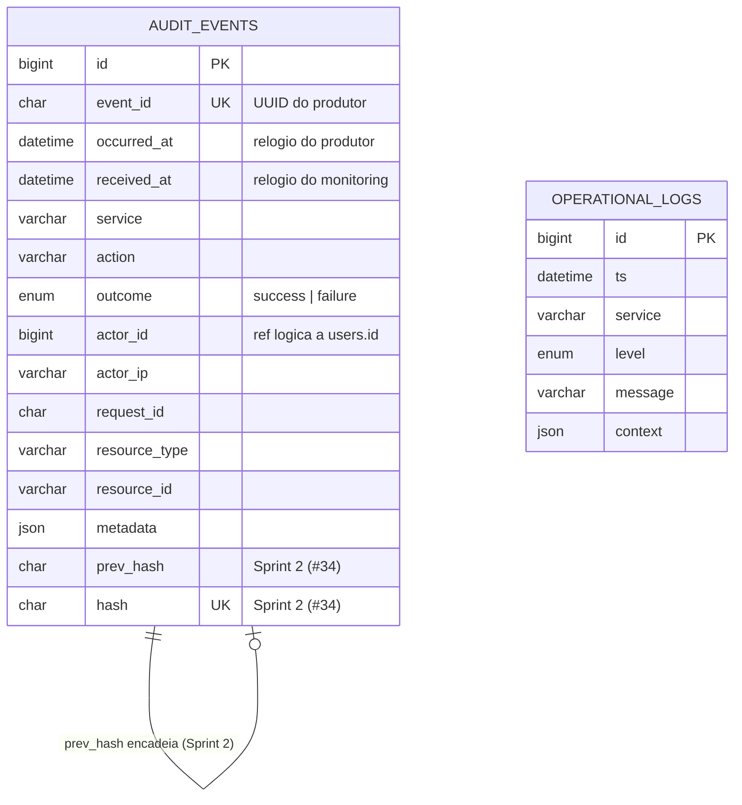

# Banco de dados do Veriditi

> Contrato único de dados do sistema (issue #41). As issues que criam tabelas seguem este documento: se uma issue divergir, **vale o que está aqui**, e a mudança atualiza este arquivo no mesmo PR.
>
> Decisões registradas em: [ADR-020](adr/0020-banco-central-compartilhado-com-posse-por-servico.md) (posse e privilégio mínimo), [ADR-021](adr/0021-datas-utc-datetime6.md) (datas em UTC), [ADR-022](adr/0022-convencoes-do-modelo-fisico.md) (convenções físicas) e [ADR-023](adr/0023-migrations-por-servico-e-testes-com-mysql.md) (migrations e testes).

## 1. Visão geral

A camada de dados tem **três armazenamentos** (seção 4.1 do documento de arquitetura, ADR-010):

| Armazenamento | Tecnologia | Conteúdo | Quem acessa |
|---|---|---|---|
| **Banco Central** (`veriditi`) | MySQL 8.4, InnoDB | usuários, sessões, créditos, pagamentos, capturas, provas (metadados) | auth, payment, capture, storage. Cada um só acessa as **próprias** tabelas |
| **Log Storage** (`veriditi_logs`) | MySQL 8.4, mesmo servidor, outro *database* (ADR-015) | trilha de auditoria imutável e logs operacionais | só o monitoring |
| **Object Storage** | MinIO, com Object Lock (ADR-019) | arquivos das provas (imagem, vídeo, HTML, manifest) | só o storage |

Todas as tabelas usam `ENGINE=InnoDB` e `utf8mb4` / `utf8mb4_0900_ai_ci`. Os nomes dos dois bancos são fixos, porque os scripts de init não expandem variáveis em `.sql`.

## 2. Modelo conceitual

- Um **Usuário** se cadastra, verifica o e-mail, configura MFA e abre **Sessões**.
- Um Usuário faz **Pedidos** de **Pacotes de créditos**; um pedido pago gera **Lançamentos** na **Carteira** de créditos.
- Um Usuário solicita **Capturas**; cada captura consome créditos (lançamento de débito) e, quando concluída, gera uma **Prova**.
- Uma Prova tem um ou mais **Arquivos** (imagem, vídeo, HTML, manifest), cada um com seu **hash SHA-256**, guardados no Object Storage.
- Toda ação gera um **Evento de auditoria**, encadeado por hash no Log Storage.
- Toda notificação enviada fica registrada por **chave de idempotência**, para não ser enviada duas vezes.

## 3. Modelo lógico do Banco Central (`veriditi`)

Linha contínua indica FK dentro do mesmo serviço. Linha tracejada indica **referência lógica** entre serviços, sem FK (seção 7). As tabelas da Sprint 1 aparecem com todas as colunas; as da Sprint 2, com as colunas que definem o modelo.



`NOTIFICATIONS_SENT` não se relaciona com `USERS`: ela guarda só o necessário para deduplicar, sem dado pessoal.

## 4. Modelo lógico do Log Storage (`veriditi_logs`)



## 5. Modelo físico da Sprint 1 (DDL final)

Este é o DDL que as migrations de #3, #5, #6, #7, #8 e #9 produzem. Os nomes de constraint e de índice vêm da `naming_convention` (seção 9). No código, os models usam os tipos de `veriditi_common.db_types`, e as migrations descrevem o tipo físico explícito.

### 5.1 `veriditi.users` (dono: auth)

```sql
CREATE TABLE users (
  id                BIGINT       NOT NULL AUTO_INCREMENT,
  email             VARCHAR(255) NOT NULL,
  name              VARCHAR(120) NOT NULL,
  password_hash     VARCHAR(255) NOT NULL,
  status            ENUM('pending_verification','active','blocked') NOT NULL DEFAULT 'pending_verification',
  email_verified_at DATETIME(6)  NULL,
  created_at        DATETIME(6)  NOT NULL DEFAULT CURRENT_TIMESTAMP(6),
  updated_at        DATETIME(6)  NOT NULL DEFAULT CURRENT_TIMESTAMP(6) ON UPDATE CURRENT_TIMESTAMP(6),
  CONSTRAINT pk_users PRIMARY KEY (id),
  CONSTRAINT uq_users_email UNIQUE (email),
  CONSTRAINT ck_users_active_requires_verified CHECK (status <> 'active' OR email_verified_at IS NOT NULL)
);
```

| Coluna | Tipo | Nulo | Padrão | Descrição | PII |
|---|---|---|---|---|---|
| `id` | BIGINT | não | auto | Identificador interno | não |
| `email` | VARCHAR(255) | não | — | E-mail normalizado pela aplicação (trim + minúsculas, #7) | **sim** |
| `name` | VARCHAR(120) | não | — | Nome exibido | **sim** |
| `password_hash` | VARCHAR(255) | não | — | String PHC do Argon2id (#7). Nunca a senha | não |
| `status` | ENUM | não | `pending_verification` | `blocked` substitui a exclusão (seção 9). `active` exige `email_verified_at` preenchido (`ck_users_active_requires_verified`, #7) | não |
| `email_verified_at` | DATETIME(6) | sim | — | Quando o código foi confirmado (#8). Obrigatório com `status = 'active'` (CHECK) | não |
| `created_at` | DATETIME(6) | não | agora (UTC) | Cadastro | não |
| `updated_at` | DATETIME(6) | não | agora (UTC) | Atualizado pelo banco (`ON UPDATE`) e pela aplicação (`onupdate=utcnow`) | não |

O `ON UPDATE` aparece só no DDL do MySQL, escrito na migration. O SQLite dos testes não tem esse recurso, e por isso o model também usa `onupdate=utcnow`.

O CHECK `ck_users_active_requires_verified` (`status <> 'active' OR email_verified_at IS NOT NULL`) impede uma conta ativa sem e-mail verificado, mesmo que a aplicação erre. A migration `0002` só o cria no MySQL, então o SQLite dos testes não o aplica.

### 5.2 `veriditi.email_verification_codes` (dono: auth)

```sql
CREATE TABLE email_verification_codes (
  id          BIGINT      NOT NULL AUTO_INCREMENT,
  user_id     BIGINT      NOT NULL,
  purpose     ENUM('email_verification','mfa') NOT NULL DEFAULT 'email_verification',
  code_hash   CHAR(64) CHARACTER SET ascii COLLATE ascii_bin NOT NULL,
  attempts    TINYINT     NOT NULL DEFAULT 0,
  expires_at  DATETIME(6) NOT NULL,
  consumed_at DATETIME(6) NULL,
  created_at  DATETIME(6) NOT NULL DEFAULT CURRENT_TIMESTAMP(6),
  CONSTRAINT pk_email_verification_codes PRIMARY KEY (id),
  CONSTRAINT fk_email_verification_codes_user_id_users FOREIGN KEY (user_id) REFERENCES users (id),
  CONSTRAINT ck_email_verification_codes_attempts_non_negative CHECK (attempts >= 0),
  INDEX ix_email_verification_codes_user_id_consumed_at (user_id, consumed_at)
);
```

| Coluna | Tipo | Nulo | Padrão | Descrição | PII |
|---|---|---|---|---|---|
| `user_id` | BIGINT | não | — | FK para `users`, com `RESTRICT`: usuário nunca é apagado | não |
| `purpose` | ENUM | não | `email_verification` | `mfa` é o fallback por e-mail do #18 | não |
| `code_hash` | CHAR(64) ascii | não | — | HMAC-SHA256 do código com `VERIFICATION_PEPPER` (#8). Com SHA-256 puro, 10⁶ códigos cairiam por força bruta se a tabela vazasse | não |
| `attempts` | TINYINT | não | 0 | Tentativas erradas; na 5ª o código é invalidado (#8) | não |
| `expires_at` | DATETIME(6) | não | — | Criação + 15 min | não |
| `consumed_at` | DATETIME(6) | sim | — | Uso bem-sucedido **ou** invalidação (novo código, 5 erros) | não |

### 5.3 `veriditi.refresh_tokens` (dono: auth)

```sql
CREATE TABLE refresh_tokens (
  id            BIGINT      NOT NULL AUTO_INCREMENT,
  user_id       BIGINT      NOT NULL,
  token_hash    CHAR(64) CHARACTER SET ascii COLLATE ascii_bin NOT NULL,
  family_id     CHAR(36) CHARACTER SET ascii COLLATE ascii_bin NOT NULL,
  expires_at    DATETIME(6) NOT NULL,
  revoked_at    DATETIME(6) NULL,
  revoke_reason ENUM('rotated','logout','reuse_detected') NULL,
  created_ip    VARCHAR(45) NULL,
  user_agent    VARCHAR(255) NULL,
  created_at    DATETIME(6) NOT NULL DEFAULT CURRENT_TIMESTAMP(6),
  CONSTRAINT pk_refresh_tokens PRIMARY KEY (id),
  CONSTRAINT uq_refresh_tokens_token_hash UNIQUE (token_hash),
  CONSTRAINT fk_refresh_tokens_user_id_users FOREIGN KEY (user_id) REFERENCES users (id),
  CONSTRAINT ck_refresh_tokens_revocation_consistent CHECK ((revoked_at IS NULL) = (revoke_reason IS NULL)),
  INDEX ix_refresh_tokens_user_id_revoked_at (user_id, revoked_at)
);
```

| Coluna | Tipo | Nulo | Padrão | Descrição | PII |
|---|---|---|---|---|---|
| `token_hash` | CHAR(64) ascii | não | — | SHA-256 do token opaco de 32 bytes (#9). O token em si nunca é gravado | não |
| `family_id` | CHAR(36) ascii | não | — | UUID da cadeia de rotação, criado no login | não |
| `expires_at` | DATETIME(6) | não | — | Criação + 7 dias | não |
| `revoked_at` / `revoke_reason` | DATETIME(6) / ENUM | sim | — | Preenchidos juntos (CHECK). `reuse_detected` alimenta a auditoria `auth.session.refresh_reuse_detected` | não |
| `created_ip` | VARCHAR(45) | sim | — | IPv4 ou IPv6 textual | **sim** |
| `user_agent` | VARCHAR(255) | sim | — | Navegador da sessão | **sim** |

### 5.4 `veriditi.notifications_sent` (dono: notification)

```sql
CREATE TABLE notifications_sent (
  id              BIGINT       NOT NULL AUTO_INCREMENT,
  idempotency_key VARCHAR(128) CHARACTER SET ascii COLLATE ascii_bin NOT NULL,
  template        VARCHAR(64)  NOT NULL,
  status          ENUM('pending','sent','failed') NOT NULL DEFAULT 'pending',
  attempts        TINYINT      NOT NULL DEFAULT 0,
  message_id      VARCHAR(255) NULL,
  created_at      DATETIME(6)  NOT NULL DEFAULT CURRENT_TIMESTAMP(6),
  sent_at         DATETIME(6)  NULL,
  CONSTRAINT pk_notifications_sent PRIMARY KEY (id),
  CONSTRAINT uq_notifications_sent_idempotency_key UNIQUE (idempotency_key),
  CONSTRAINT ck_notifications_sent_attempts_non_negative CHECK (attempts >= 0),
  CONSTRAINT ck_notifications_sent_sent_requires_sent_at CHECK (status <> 'sent' OR sent_at IS NOT NULL)
);
```

| Coluna | Tipo | Nulo | Padrão | Descrição | PII |
|---|---|---|---|---|---|
| `idempotency_key` | VARCHAR(128) ascii | não | — | Gerada pelo produtor (ex.: `email_verification:<code_id>`) | não |
| `template` | VARCHAR(64) | não | — | Ex.: `email_verification`, `welcome` | não |
| `status` | ENUM | não | `pending` | `pending` na reserva; `sent` ou `failed` só pelo UPDATE condicional do fim do envio (`failed` depois das 3 tentativas ou de um erro 5xx) | não |
| `attempts` | TINYINT | não | 0 | Tentativas de envio SMTP, gravadas só no fim: 0 enquanto `pending` | não |
| `message_id` | VARCHAR(255) | sim | — | `Message-ID` (com `<>`) gerado pelo notification no domínio do `SMTP_FROM`, igual em todas as tentativas. Gravado só em `sent`; em `failed` fica NULL | não |
| `sent_at` | DATETIME(6) | sim | — | Obrigatório quando `status = 'sent'` | não |

O destinatário **não** é gravado: deduplicar não precisa dele, e a auditoria já registra o e-mail mascarado (#6).

**Ciclo de vida (#6).** O `POST /internal/notifications` valida o `data`, renderiza o e-mail e só então reserva a chave com um `INSERT` (`pending`, `attempts = 0`), sem SELECT antes. O `202` sai depois do COMMIT, e o envio roda depois da resposta. No fim, um `UPDATE … SET status, attempts, message_id, sent_at WHERE id = :id AND status = 'pending'` grava `sent` ou `failed`; uma linha terminada nunca regride.

| Situação no POST | Ação | E-mail | Auditoria |
|---|---|---|---|
| Chave nova | `INSERT` `pending`, COMMIT, agenda o envio | sim, depois da resposta | `notification.email.sent` ou `.failed` no fim |
| Chave existente `pending` | 1062 → `SELECT status` só para o log `notification_duplicate` | não (em andamento ou órfã) | não |
| Chave existente `sent` | idem | não | não |
| Chave existente `failed` | idem: **terminal na Sprint 1** | não | não |

O `failed` não reenvia porque a deduplicação é permanente (§14), o `HttpNotifier` não repete o POST e o reenvio do código no auth (#8/#13) gera um código novo, com chave nova. O reprocessamento fica para o outbox do #37; só um `welcome` que falhar se perde.

**`pending` órfão.** Se o processo morrer entre o COMMIT da reserva e o fim do envio (SIGKILL, OOM, deploy), a linha fica `pending` para sempre e a chave fica bloqueada. Não há como retomar: destinatário e `data` não são gravados, por desenho. Mitigações: `stop_grace_period: 65s` no compose (o uvicorn espera o envio terminar), o reenvio do código no auth e esta consulta de detecção (sem índice: a tabela é pequena; o índice entra no #35/#37):

```sql
SELECT id, idempotency_key, template, created_at
FROM notifications_sent
WHERE status = 'pending' AND created_at < UTC_TIMESTAMP(6) - INTERVAL 10 MINUTE;
```

O `stop_grace_period` cobre o pior caso de um envio, com `SMTP_TIMEOUT_SECONDS = 10` (T). Envios simultâneos correm em paralelo, então o pior caso não soma entre eles:

| Etapa | Teto | Entrega na 3ª tentativa | 3 tentativas falhas |
|---|---|---|---|
| Tentativa que falha (conexão, TLS, AUTH e envio, num `asyncio.timeout` só) | T | 2 × 10 s | 3 × 10 s |
| Esperas entre tentativas | 1 s + 2 s | 3 s | 3 s |
| Tentativa que entrega | T | 10 s | — |
| `QUIT` depois da entrega, fora do timeout da tentativa e sem mudar o resultado | T | 10 s | — |
| `UPDATE` final (conexão do pool e lock incluídos); estourado, vira `notification_status_update_failed` e a linha fica `pending` | 5 s | 5 s | 5 s |
| Auditoria: o `timeout=2.0` do httpx vale por fase (pool, conexão, escrita e leitura) | 4 × 2 s | 8 s | 8 s |
| **Total** | 4T + 16 s | **56 s** | **46 s** |

Os 65 s deixam 9 s para o resto do shutdown. Com `SMTP_TIMEOUT_SECONDS` maior que 10, suba o `stop_grace_period` para pelo menos 4T + 16 s mais a folga.

### 5.5 `veriditi_logs.audit_events` (dono: monitoring)

```sql
CREATE TABLE audit_events (
  id            BIGINT      NOT NULL AUTO_INCREMENT,
  event_id      CHAR(36) CHARACTER SET ascii COLLATE ascii_bin NOT NULL,
  occurred_at   DATETIME(6) NOT NULL,
  received_at   DATETIME(6) NOT NULL DEFAULT CURRENT_TIMESTAMP(6),
  service       VARCHAR(40) NOT NULL,
  action        VARCHAR(80) NOT NULL,
  outcome       ENUM('success','failure') NOT NULL,
  actor_id      BIGINT      NULL,
  actor_ip      VARCHAR(45) NULL,
  request_id    CHAR(36) CHARACTER SET ascii COLLATE ascii_bin NULL,
  resource_type VARCHAR(40) NULL,
  resource_id   VARCHAR(64) NULL,
  metadata      JSON        NULL,
  CONSTRAINT pk_audit_events PRIMARY KEY (id),
  CONSTRAINT uq_audit_events_event_id UNIQUE (event_id),
  INDEX ix_audit_events_actor_id_occurred_at (actor_id, occurred_at),
  INDEX ix_audit_events_action_occurred_at (action, occurred_at)
);
```

| Coluna | Tipo | Nulo | Padrão | Descrição | PII |
|---|---|---|---|---|---|
| `event_id` | CHAR(36) ascii | não | — | UUID gerado pelo produtor; deduplica reenvios. A primeira escrita vence; um reenvio com conteúdo diferente gera o warning `audit_event_conflict` com os nomes dos campos divergentes, sem valores | não |
| `occurred_at` | DATETIME(6) | não | — | Relógio do produtor | não |
| `received_at` | DATETIME(6) | não | agora (UTC) | Relógio confiável do monitoring (#5), gravado explicitamente pelo caso de uso. O DEFAULT é a defesa para INSERT manual | não |
| `service` / `action` | VARCHAR | não | — | `action` segue `<serviço>.<entidade>.<verbo_passado>` (#4) | não |
| `actor_id` | BIGINT | sim | — | `veriditi.users.id` lógico; `NULL` = anônimo ou sistema | não |
| `actor_ip` | VARCHAR(45) | sim | — | IP de origem | **sim** |
| `request_id` | CHAR(36) ascii | sim | — | Correlação com os logs da aplicação (`X-Request-ID`) | não |
| `metadata` | JSON | sim | — | Nunca guarda senha, token ou código: o valor de toda chave sensível, em qualquer nível, vira `[redacted]` pelo `veriditi_common.logging.redact` (a mesma regra `is_sensitive_key` dos logs) e a chave fica. `{}` é gravado como NULL e NULL volta como `{}` na API. No model, o atributo Python se chama `metadata_`, porque `metadata` é reservado no SQLAlchemy declarativo | depende |

`prev_hash` e `hash` (`CHAR(64)`, `hash` UNIQUE) entram na migration do **#34**, junto com o encadeamento.

- Limites de entrada (#5): o `metadata` tem no máximo 16 KiB em JSON compacto (UTF-8) e 8 níveis de aninhamento, contando o próprio objeto; acima disso, 422. O corpo do `POST /internal/events` tem no máximo 64 KiB (`BodySizeLimitMiddleware` da lib, pelo `Content-Length` ou contando o stream), acima disso, `413 payload_too_large`. Um aninhamento acima do limite de recursão do `json.loads` (por volta de 10 mil níveis, o que cabe em 64 KiB) nem chega à validação: o FastAPI responde `400 http_error` ao ler o corpo. Por consequência, uma página do `GET` com `limit=200` fica em torno de 200 × 17 KiB ≈ 3,4 MB.
- O JSON do MySQL guarda número com casa decimal como double e o devolve com 16 dígitos significativos (`1794481488.1332421` volta `1794481488.133242`): o `metadata` não preserva os 17 dígitos que o Python escreve. Por isso a comparação do `audit_event_conflict` usa `math.isclose(rel_tol=1e-15)` para floats. Valores que precisam de precisão exata devem ir como string ou inteiro.
- As regras abaixo e os limites do `metadata` ficam no `AuditEvent` da lib, então o produtor nem consegue montar um evento que o monitoring recusaria; o `AuditEventIn` só tira os defaults. Viram 422 na entrada, não 500 no INSERT: `occurred_at` fora dos anos 1000 a 9999 depois da conversão para UTC (inclusive o estouro de `astimezone`, também no `from`/`to` do GET); `NaN` e `Infinity`; texto com surrogate solto (`\ud800`), em chaves e valores do `metadata` e em `resource_type`/`resource_id`. Também viram 422 os inteiros fora da faixa do BIGINT com sinal (−2⁶³ a 2⁶³−1). Esse limite não é uma recusa do MySQL: acima dele, o JSON guarda o número como uint64 ou o converte em double sem avisar, perdendo precisão; um número que não cabe nem em double, aí sim, é recusado.
- A redação do `metadata` é por **nome de chave**: um segredo no valor de uma chave neutra (`note: "Bearer …"`) passa. Não pôr segredo em valores é responsabilidade do produtor.
- Um INSERT duplicado consome um `id` (o InnoDB não devolve o `AUTO_INCREMENT`), então os ids não são contíguos.
- A ordem do `id` é a da reserva do `AUTO_INCREMENT`, não a dos COMMITs: uma transação lenta pode confirmar o `id` 6 depois que o 7 já está visível. O cursor `after_id` é estável para paginar dados já confirmados, mas **não serve para acompanhar a cauda** com escritas concorrentes: quem leu até o 7 nunca verá o 6. Nota para o #34: o encadeamento e qualquer leitura incremental precisam de uma marca d'água atrasada (`received_at < now() - Δ`, com Δ maior que a transação mais longa) ou de uma sequência gerada sob lock na mesma transação do INSERT. `occurred_at` também não serve, porque depende do relógio do produtor.

## 6. Índices e as consultas que eles atendem

Regra: **nenhum índice sem uma consulta real**. A chave primária e as FKs não aparecem na tabela. O InnoDB exige índice na coluna de FK, e os índices compostos abaixo já começam por ela.

| Índice | Consulta | Issue |
|---|---|---|
| `uq_users_email` | Login: `SELECT id, password_hash, status FROM users WHERE email = :email`. No cadastro, a violação do UNIQUE vira 409 sem SELECT prévio | #7, #9 |
| `ix_email_verification_codes_user_id_consumed_at` | Código ativo: `SELECT … WHERE user_id = :uid AND consumed_at IS NULL AND purpose = :p ORDER BY id DESC LIMIT 1 FOR UPDATE`. Invalidar os anteriores: `UPDATE … SET consumed_at = :now WHERE user_id = :uid AND consumed_at IS NULL`. Cooldown e limite de reenvio: `SELECT COUNT(*) … WHERE user_id = :uid AND created_at >= :since` (o prefixo `user_id` reduz a busca a poucas linhas por usuário) | #8 |
| `uq_refresh_tokens_token_hash` | Refresh e logout: `SELECT … FROM refresh_tokens WHERE token_hash = :h FOR UPDATE` | #9 |
| `ix_refresh_tokens_user_id_revoked_at` | Reuso detectado revoga **todos** os tokens do usuário: `UPDATE refresh_tokens SET revoked_at = :now, revoke_reason = 'reuse_detected' WHERE user_id = :uid AND revoked_at IS NULL` | #9 |
| `uq_notifications_sent_idempotency_key` | Reserva idempotente: `INSERT …`. A violação significa "já enviado, em andamento ou falhou", e então `SELECT status … WHERE idempotency_key = :k` só para o log. Deadlock (1213) repete o INSERT uma vez; 1205 sobe. O fim do envio atualiza pela PK: `UPDATE … WHERE id = :id AND status = 'pending'` | #6 |
| `uq_audit_events_event_id` | Ingestão idempotente: `INSERT …`. `IntegrityError` → 202 sem duplicar. Deadlock (1213) repete o INSERT uma vez; lock wait timeout (1205) não, porque já esperou 50 s | #5 |
| `ix_audit_events_actor_id_occurred_at` | `GET /internal/events?actor_id=&from=&to=` e as atividades do usuário (RF20): `WHERE actor_id = :uid AND occurred_at >= :from AND occurred_at < :to AND id > :after ORDER BY id LIMIT :n`. O `ORDER BY id` faz filesort só das linhas filtradas | #5, #34 |
| `ix_audit_events_action_occurred_at` | `GET /internal/events?action=&from=&to=`: `WHERE action = :a AND occurred_at >= :from AND occurred_at < :to AND id > :after ORDER BY id LIMIT :n` (filesort só das linhas filtradas) | #5 |

Índices que **não** existem, e por quê:
- `refresh_tokens.family_id`: nenhuma consulta da Sprint 1 filtra por família, porque o reuso revoga por usuário. O índice entra junto com a primeira consulta por família.
- `notifications_sent.status` e `created_at`: entram com a limpeza ou o reprocessamento (#35/#37).
- `audit_events.occurred_at` sozinho: o `GET /internal/events` só com `from`/`to` varre a PK até completar o `limit`. A rota é interna; um keyset `(occurred_at, id)` fica para o volume do RF20 (#34).

Índices previstos para a Sprint 2 (#41): `ix_credit_ledger_user_id_id` (extrato paginado), `ix_captures_user_id_requested_at` ("Minhas provas") e `ix_evidence_files_sha256` (verificação pública por hash).

## 7. Matriz de posse e privilégios

**Regra de ouro:** um serviço **nunca** lê ou escreve tabela de outro. Se o `capture` precisa do preço, pergunta ao `payment` pela API. Por isso **não há FOREIGN KEY entre tabelas de serviços diferentes**: `orders.user_id`, por exemplo, é referência lógica. Dentro do mesmo serviço, FK é obrigatória.

| Tabela | Banco | Dono (escrita) | Usuário de runtime | Privilégios | Sprint |
|---|---|---|---|---|---|
| `users` | veriditi | auth | `auth_svc` | SELECT, INSERT, UPDATE (**sem DELETE**: usuário vira `blocked`) | 1 |
| `email_verification_codes`, `refresh_tokens` | veriditi | auth | `auth_svc` | SELECT, INSERT, UPDATE, DELETE (expurgo de expirados) | 1 |
| `user_mfa`, `mfa_recovery_codes`, `password_reset_tokens` | veriditi | auth | `auth_svc` | a definir na issue (#18, #19) | 2 |
| `notifications_sent` | veriditi | notification | `notification_svc` | SELECT, INSERT, UPDATE | 1 |
| `credit_packages`, `capture_prices`, `orders`, `credit_wallets` | veriditi | payment | `payment_svc` | a definir (#21–#24) | 2 |
| `credit_ledger` | veriditi | payment | `payment_svc` | SELECT, INSERT (**append-only**) | 2 |
| `captures` | veriditi | capture | `capture_svc` | a definir (#29) | 2 |
| `evidences`, `evidence_files` | veriditi | storage | `storage_svc` | SELECT, INSERT (provas nunca mudam) | 2 |
| `<serviço>_outbox` | veriditi | cada produtor | o do serviço | SELECT, INSERT, UPDATE (o relay marca `published_at`) | 2 |
| `audit_events` | veriditi_logs | monitoring | `veriditi_logs_writer` | SELECT, INSERT (**append-only**, ADR-015) | 1 |
| `operational_logs` | veriditi_logs | monitoring | `veriditi_logs_writer` (+ usuário de limpeza com DELETE) | SELECT, INSERT | 2 |

Nenhuma tabela é lida por outro serviço na Sprint 1.

## 8. Object Storage (MinIO)

| Bucket | Chave | Retenção | Acesso |
|---|---|---|---|
| `evidences` | `{user_id}/{capture_id}/{kind}.{ext}` e `…/manifest.json` | Object Lock **COMPLIANCE**, `EVIDENCE_RETENTION_DAYS` (padrão 5 anos) | só `storage` |
| `log-archive` | `operational/{yyyy}/{mm}/{dd}/{lote}.jsonl.gz` | 1 ano | só `monitoring` |
| `backups` (outro provedor) | `mysql/{db}/{data}.sql.gz` e espelho de `evidences` | 30 dias | rotina de backup |

O MySQL guarda só os metadados do arquivo (`object_key`, `version_id`, `sha256`, `size_bytes`). Blob no MySQL é proibido.

## 9. Convenções

| Tema | Regra | Por quê |
|---|---|---|
| Nomes | `snake_case`, tabela no plural, PK `id`, FK `<entidade>_id`. Constraints pela `naming_convention`: `pk_<tabela>`, `uq_<tabela>_<cols>`, `ix_<tabela>_<cols>`, `fk_<tabela>_<cols>_<referida>`, `ck_<tabela>_<nome>` | Previsível; o Alembic compara e remove constraints de forma confiável. Toda CHECK precisa de `name=` |
| Identificadores | `BIGINT AUTO_INCREMENT` para entidades internas; **UUID `CHAR(36)`** para o que aparece na URL (`orders`, `captures`, `evidences`) | UUID impede enumerar provas de outros usuários |
| Datas | `DATETIME(6)` sempre em **UTC** (ADR-021); a conversão de fuso acontece só na web | Precisão exigida pela ADR-001; fuso no banco gera ambiguidade |
| Dinheiro | `INT` em centavos | `FLOAT` gera erro de arredondamento |
| Segredos | Códigos, tokens e recovery codes só como hash `CHAR(64)` hex; segredo TOTP cifrado (`VARBINARY`) | Um vazamento do banco não entrega sessões |
| Texto gerado por código | Hashes, UUIDs e chaves de idempotência em `CHARACTER SET ascii COLLATE ascii_bin` | Ocupa 64 bytes em vez de até 256 em `utf8mb4`, e a comparação é exata (byte a byte) |
| Status | `ENUM` pequeno e estável; mudança via migration | Integridade no próprio banco |
| Charset | `utf8mb4` / `utf8mb4_0900_ai_ci`, InnoDB | Acentos e emojis; transações e locks de linha |
| Exclusão | Provas, ledger e auditoria **nunca** são apagados (append-only); usuário removido vira `status = 'blocked'` + anonimização (LGPD) | Valor probatório e rastreabilidade |
| Concorrência | Atualização condicional (`WHERE status = 'pending'`, `WHERE balance >= n`) em vez de ler e depois gravar | Evita condição de corrida sem locks longos |
| FK | Dentro do serviço, sempre, com `RESTRICT` (padrão); entre serviços, nunca | Posse por serviço (seção 7) |

### Tipos em `veriditi_common.db_types`

Os models usam estes tipos. Eles mantêm o mesmo comportamento no MySQL e no SQLite dos testes:

| Tipo | MySQL | SQLite | Regra |
|---|---|---|---|
| `BigIntPK` | `BIGINT` | `INTEGER` | Só `INTEGER PRIMARY KEY` autoincrementa no SQLite |
| `UTCDateTime()` | `DATETIME(6)` | `DATETIME` | Recusa datetime naive, grava UTC e devolve aware em UTC |
| `UtcNow()` (`server_default`) | `CURRENT_TIMESTAMP(6)` | `STRFTIME(… 'now')` | Sessão MySQL em UTC (`create_service_engine`) |
| `utcnow()` | — | — | `default=` / `onupdate=` do lado Python |
| `HashHex()` | `CHAR(64)` ascii_bin | `CHAR(64)` | Normaliza para minúsculas e valida o hex |
| `UUIDStr()` | `CHAR(36)` ascii_bin | `CHAR(36)` | O `sa.Uuid` geraria `CHAR(32)` sem hífens |
| `ascii_string(n)` | `VARCHAR(n)` ascii_bin | `VARCHAR(n)` | Chaves geradas por código |
| `str_enum(Enum, "status")` | `ENUM(...)` | `VARCHAR` + `ck_<tabela>_status` | Grava o valor (`"active"`), não o nome |

Cada serviço declara a própria `Base` com `metadata = make_metadata()` (`veriditi_common.db`).

## 10. Usuários MySQL e scripts de init

| Usuário | Para quê | Criado em |
|---|---|---|
| `root` | Só o initdb e a administração | imagem `mysql` |
| `migrator` | Alembic de todos os serviços: DDL + DML em `veriditi.*` e `veriditi_logs.*` `WITH GRANT OPTION` | `02-service-users.sh` |
| `auth_svc`, `notification_svc` | Runtime dos serviços do Banco Central | `02-service-users.sh` |
| `veriditi_logs_writer` | Runtime do monitoring | `02-service-users.sh` |
| `payment_svc`, `capture_svc`, `storage_svc` | Runtime da Sprint 2 | Sprint 2, nas issues dos serviços |

- `docker/mysql/init/01-logs-db.sql`: fixa a collation do `veriditi` e cria o `veriditi_logs`.
- `docker/mysql/init/02-service-users.sh`: cria os usuários com as senhas de `DB_MIGRATOR_PASSWORD`, `AUTH_DB_PASSWORD`, `NOTIFICATION_DB_PASSWORD` e `LOGS_DB_PASSWORD`.
  - É `.sh` porque o initdb não expande `${VAR}` em `.sql`. O arquivo não é executável, para que o entrypoint faça `source` e exponha o `docker_process_sql`.
  - Falha o container se faltar uma senha ou se ela tiver `'` ou `\`.
  - Pode ser reaplicado (`CREATE USER IF NOT EXISTS` + `ALTER USER`): `docker compose exec mysql bash /docker-entrypoint-initdb.d/02-service-users.sh`.
- Os scripts **só rodam com o volume vazio**. Depois de mudá-los: `docker compose down -v`.
- Se o init falhar (senha faltando ou com `'`/`\`), o MySQL reinicia com o datadir já criado e **não roda o init de novo**. Por isso o healthcheck do compose exige que os quatro usuários existam em vez de só responder ao ping: o `mysql` fica `unhealthy` e os `*-migrate` não chegam a rodar com erro 1045. Corrija o `.env` e rode `make reset`.
- O initdb **não concede nenhum privilégio de tabela**. As tabelas ainda não existem nessa hora, e o MySQL só aceita GRANT de SELECT/INSERT em tabela existente. Cada GRANT nasce na migration que cria a tabela (seção 11).
- Um usuário sem nenhum privilégio num banco **nem consegue conectar** a ele (erro 1044). Por isso o `<serviço>-migrate` precisa terminar antes de o serviço subir.

Cada container recebe as próprias variáveis `DB_USER`, `DB_PASSWORD` e `DB_NAME` (`ServiceSettings.database_url`), além de `DB_MIGRATOR_USER` e `DB_MIGRATOR_PASSWORD` no container de migração (`ServiceSettings.migration_database_url`). O compose faz o mapeamento desde o #3: `AUTH_DB_PASSWORD` → `DB_PASSWORD` do auth, `NOTIFICATION_DB_PASSWORD` → do notification e `LOGS_DB_PASSWORD` → do monitoring (com `DB_NAME=veriditi_logs`). Os três têm um `<serviço>-migrate` (`auth-migrate`, `notification-migrate`, `monitoring-migrate`), o único que recebe `DB_MIGRATOR_*`, e o serviço só sobe depois que ele termina. O Makefile faz a mesma tradução para `make dev`/`make migrate s=<serviço>`.

## 11. Política de migrations

- **Uma pasta `migrations/` e uma `version_table` por serviço**: `alembic_version_<serviço>`. Sem isso, dois serviços no mesmo banco disputariam a mesma `alembic_version`.
- **Histórico linear**: no máximo 1 head por serviço (0 enquanto o serviço ainda não tem revisão; desde o #6, os 3 serviços com banco têm 1 head). Se dois PRs criarem a mesma revisão, quem mergear por último rebaseia e renumera.
- Revisões sequenciais (`0001`, `0002`, …) em arquivos `YYYYMMDD_<rev>_<slug>.py`.
- **Uma revisão mergeada na `main` nunca é editada**; a mudança vem numa nova. A única exceção é o rebaseline do #3 (`users` → `auth`), aceito porque ainda não existe ambiente implantado e a troca de `version_table` já exige recriar o volume.
- **Migrations não importam models**: usam tipos físicos explícitos (`mysql.DATETIME(fsp=6)`, `mysql.CHAR(64, charset="ascii", collation="ascii_bin")`, `sa.text("CURRENT_TIMESTAMP(6)")`). Assim uma migration antiga continua igual mesmo que o model mude.
- **A tabela e o GRANT nascem juntos**, na mesma revisão. O usuário alvo vem do `DB_USER` do container de migração:
  ```python
  grant_table_privileges(
      op.get_bind(),
      table="users",
      privileges=["SELECT", "INSERT", "UPDATE"],
      user=context.config.attributes["runtime_db_user"],
  )
  ```
  O `downgrade` chama `revoke_table_privileges` **antes** do `DROP`, porque o MySQL não revoga privilégios de tabela apagada.
- Toda revisão tem `downgrade()` funcional. O CI (job `database`, criado no #3) roda `make db-test`, que num MySQL descartável com `docker/mysql/init` executa os testes marcados como `mysql` e, para cada serviço com `alembic.ini`:
  1. `alembic heads` (no máximo 1 linha);
  2. `upgrade head`;
  3. `alembic check`;
  4. `downgrade base`;
  5. `upgrade head`;
  6. confere que `alembic_version_<serviço>` existe no banco do serviço (pega um `VERSION_TABLE` copiado errado).
- As migrations rodam como `migrator`; os serviços nunca têm DDL.

## 12. Plano de migrations da Sprint 1

| Serviço / `version_table` | Revisão | `down_revision` | Issue | Conteúdo |
|---|---|---|---|---|
| auth / `alembic_version_auth` | `0001` | — | #3 (rebaseline de `users`) | `users(id, email, name, created_at)` com os tipos finais + GRANT ao `auth_svc` |
| auth | `0002` | `0001` | #7 | `password_hash`, `status`, `email_verified_at`, `updated_at` + `ck_users_active_requires_verified` |
| auth | `0003` | `0002` | #8 | `email_verification_codes` + GRANT |
| auth | `0004` | `0003` | #9 | `refresh_tokens` + GRANT |
| notification / `alembic_version_notification` | `0001` | — | #6 | `notifications_sent` + GRANT ao `notification_svc` |
| monitoring / `alembic_version_monitoring` (banco `veriditi_logs`) | `0001` | — | #5 | `audit_events` + GRANT ao `veriditi_logs_writer` |

Se o #9 mergear antes do #8, os números das duas revisões trocam. As duas dependem só de `users`.

## 13. Sprint 2: notas do modelo lógico

O DER da seção 3 é a referência. O DDL físico nasce em cada issue, que atualiza este documento no mesmo PR.

- **Outbox** (#37): uma tabela por produtor (`auth_outbox`, `payment_outbox`, …), gravada na mesma transação da regra de negócio.
  - Colunas: `id`, `event_id` UUID UQ, `event_type`, `payload` JSON, `occurred_at`, `published_at` NULL, `attempts`.
  - Índice `(published_at, id)` para o relay (`WHERE published_at IS NULL ORDER BY id LIMIT n`).
- **Consumidores idempotentes**: `audit_events.event_id` e `notifications_sent.idempotency_key` já cumprem esse papel.
- **Créditos**: `credit_wallets.balance` tem `CHECK (balance >= 0)`. O débito é condicional (`UPDATE … SET balance = balance - :n WHERE user_id = :uid AND balance >= :n`) e cada movimento gera uma linha em `credit_ledger`, com `balance_after`.
- **Provas**: `evidences.retention_until` acompanha o Object Lock; `evidence_files.sha256` é indexado para a verificação pública.

## 14. Divergências com as issues

Conferido contra o texto das issues em 2026-11-12. Vale o que está neste documento.

| Issue | O que diz | Decisão | Justificativa |
|---|---|---|---|
| #7, #8, #9 | `DATETIME` / `CURRENT_TIMESTAMP` | `DATETIME(6)` + `CURRENT_TIMESTAMP(6)`, em UTC | Convenção do #41. O MySQL exige o mesmo fsp no tipo e no default |
| #7 | `updated_at … ON UPDATE CURRENT_TIMESTAMP` | Mantido com fsp 6 no DDL do MySQL, mais `onupdate=utcnow` no model | O SQLite dos testes não tem `ON UPDATE` |
| #5 | Índices `ix_actor_time` e `ix_action_time` | `ix_audit_events_actor_id_occurred_at`, `ix_audit_events_action_occurred_at` | `naming_convention` |
| #5 | `audit_events` sem `prev_hash`/`hash`; o #41 os tem no DER | Entram na migration do #34 | O #5 adia o encadeamento para o #34 |
| #5 | `services/ingest_event.py` | `use_cases/ingest_event.py` e `use_cases/list_events.py`, atrás de `ports.AuditEventRepository` | Padrão do projeto: `ports.py` + `adapters/` + `use_cases/` + `dependencies.py` |
| #5 | Filtrar `password`, `token`, `code` e `secret` do `metadata` | `redact` da lib (`is_sensitive_key`, superconjunto desses nomes): o valor vira `[redacted]` e a chave fica | A mesma regra dos logs; a chave preservada mostra o bug no produtor |
| #5 | O endpoint "recebe um `AuditEvent`" | `AuditEventIn(AuditEvent)` com `event_id`, `occurred_at` e `request_id` obrigatórios (`request_id` aceita `null` explícito) | Os defaults do produtor gerariam um `event_id` novo a cada reenvio, usariam o relógio do monitoring e herdariam o `X-Request-ID` do próprio POST |
| #5 | `received_at DEFAULT CURRENT_TIMESTAMP(6)` | DEFAULT mantido, mas o caso de uso grava o relógio injetado | Testável; o DEFAULT cobre INSERT manual |
| #5 | "Paginado por cursor `id`" | `after_id` exclusivo, `id` crescente, `limit` 50 (máx. 200, fora disso 422) e `next_cursor` | Paginação estável dos eventos já confirmados. Não acompanha a cauda com escritas concorrentes (§5.5 e §15) |
| #5 | `occurred_at BETWEEN :from AND :to` | `occurred_at >= :from AND occurred_at < :to`; `from > to` dá 422 no formato de validação, com `type` `invalid_time_range` em `["query","from"]` | Janelas vizinhas não contam o mesmo evento duas vezes |
| #5 | `metadata JSON NULL` sem regra | `{}` vira NULL de SQL (`JSON(none_as_null=True)`) e NULL volta como `{}` | Sem `none_as_null`, o SQLAlchemy gravaria o JSON `null` |
| #5 | Corpo do 202 não definido | `{"status":"accepted"}`, igual para evento novo e reenvio, só depois do COMMIT | O produtor trata o 202 como "gravado"; falha no banco é 500 e cai no fallback |
| #6 | `notifications_sent(idempotency_key PK, template, sent_at)` | `id` PK + `uq_notifications_sent_idempotency_key`, mais `status`, `attempts` e `message_id` | Mesma garantia de deduplicação. A PK curta e sequencial evita *page splits* no índice clusterizado, e os índices secundários não carregam uma chave de 128 bytes. O status distingue entregue, falha e em andamento, e deixa detectar o `pending` órfão (§5.4) |
| #6 | "repetida em até 24 h não reenvia" | A deduplicação é permanente até a limpeza (#35/#37) | Mais forte que o pedido e sem consulta por janela |
| #6 | Envio em `BackgroundTasks` | Fila `defer` do `RequestContextMiddleware`, atrás da porta `Scheduler` | As `BackgroundTasks` se perdem numa resposta de erro; a fila mantém o `request_id`, e o evento de auditoria herda o `X-Request-ID` do produtor |
| #6 | "até 3 tentativas com backoff (1 s, 2 s, 4 s)" | No máximo 3 envios, com esperas de 1 s e 2 s; 5xx encerra na hora | O §5.4 e o RF11 dizem 3 tentativas, e o 4 s só existiria numa 4ª. Trocar é mudar o `RetryPolicy.delays` para `(1.0, 2.0, 4.0)` |
| #6 | `message_id` "devolvido pelo SMTP" (este documento) | Gerado pelo notification (`make_msgid`), igual em todas as tentativas, gravado só em `sent` | O aiosmtplib não devolve o id; o Message-ID repetido deixa o MTA deduplicar uma entrega dupla |
| #6 | Status `failed` sem regra | `failed` é terminal: a chave repetida não reenvia | Recuperação pelo reenvio do código no auth (chave nova); reprocessamento no #37 |
| #6 | Sucesso registra "só template, destinatário mascarado e `message_id`" | Mais `attempts` e `idempotency_key` no `metadata`; `resource_id` = `notifications_sent.id` | Nenhum dos dois é conteúdo nem PII; a chave (até 128) não cabe no `resource_id` (até 64) |
| #6 | "422 com a lista de templates válidos" | Formato de validação do FastAPI: `type` `unknown_template` em `["body","template"]`, com a lista ordenada no `msg` | Um único formato de 422 por endpoint, como o `invalid_time_range` do #5 |
| #6 | Link de boas-vindas não definido | `{WEB_URL}/entrar`; a verificação aponta para `{WEB_URL}/verificar-email` | Rotas existentes em `apps/web/src/app/(public)` |
| #8 | Sem `purpose`; `TINYINT` | `purpose ENUM('email_verification','mfa')` (DER do #41) | O MFA por e-mail (#18) reaproveita a tabela |
| #8, #9 | `REFERENCES users(id)` sem regra | FK nomeada com `RESTRICT` | Usuário nunca é apagado |
| #9 | Sem motivo da revogação | `revoke_reason` + CHECK de consistência | Distingue rotação, logout e roubo na auditoria |
| #9 | `family_id` sem índice; o harness sugeria um | Sem índice na Sprint 1 | O reuso revoga por usuário; nenhuma consulta usa `family_id` |
| #3, #5 | `LOGS_DB_MIGRATOR_*` separado | Um único `migrator` para os dois bancos | Uma credencial de DDL a menos para gerenciar; o runtime continua separado |
| #3 | `LogsDbSettings` / `env_prefix="LOGS_DB_"` para o monitoring | O monitoring usa o `ServiceSettings` com `db_name = "veriditi_logs"` como padrão; o compose mapeia `LOGS_DB_PASSWORD` para `DB_PASSWORD` | Um único `migrator` (acima); nome do banco e do usuário são fixos pelo init, então só a senha vai para o `.env` |
| #3 | Compose sobe 9 serviços, sem `notification-migrate` | Entra o `notification-migrate` | O notification é dono de `notifications_sent` (seções 7 e 12) e a seção 10 exige `<serviço>-migrate` antes do serviço; até o #6, com `versions/` vazia, ele só criava a `alembic_version_notification` |
| #3 | Healthcheck em `/health/ready` checa o banco | Os três serviços com banco checam: o `auth` desde o #3, o `monitoring` desde o #5 e o `notification` desde o #6, que cria a tabela dele | Antes do #6, sem nenhum GRANT, o `notification_svc` nem conectava (1044, seção 10), e o compose ficaria `unhealthy` |
| #3 | Job `database`: `alembic heads` com 1 linha | No máximo 1 linha (0 enquanto o serviço não tem revisão) | Notification e monitoring nascem sem revisão; com qualquer revisão, a regra de 1 head continua (seção 11) |
| #3 | `01-logs-db.sql` cria o usuário `veriditi_logs_writer` | O usuário é criado em `02-service-users.sh` | A senha vem do ambiente, e `.sql` não expande `${VAR}` |
| #41 (exemplo) | `02-service-users.sql` com `${AUTH_DB_PASSWORD}` e GRANT no init | `.sh` + GRANT na migration | Mesmo motivo; GRANT de SELECT/INSERT exige tabela existente |
| #41 (exemplo) | `auth_svc` com DELETE em `users` | Sem DELETE em `users` | Convenção de exclusão do próprio #41 (`blocked` + anonimização) |
| #41 (critério) | "o payment não consegue ler `refresh_tokens`" | Provado com `notification_svc` até o `payment_svc` existir (#21) | O usuário do payment só nasce na Sprint 2 |
| #2 | ADRs 001–019 já reservadas | Novas ADRs: 020–023 | Evita colisão de numeração |

## 15. Riscos e perguntas em aberto

- **Volume de desenvolvimento**: os scripts de init só rodam com o volume vazio. Todo mundo precisa de `docker compose down -v` no #3 (troca de usuários e rebaseline).
- **`utf8mb4_0900_ai_ci` em `users.email`**: o UNIQUE ignora caixa (desejável) e acentos (`joão@` = `joao@`). E-mails com acento são raros. **Pergunta ao time**: vale usar `utf8mb4_0900_as_cs` só nessa coluna?
- **`migrator` com `GRANT OPTION`** nos dois bancos é a credencial mais sensível depois do root. Em produção, ela deve ficar só no job de migração.
- **`ENUM` nativo**: adicionar valor no fim é um `ALTER` instantâneo; remover ou reordenar exige migration cuidadosa.
- **Retenção e LGPD** de `actor_ip`, `created_ip` e `user_agent`: definir prazos com o time (#35).
- **Cursor por `id` e escritas concorrentes**: o `AUTO_INCREMENT` é reservado no INSERT e fica visível só no COMMIT, fora de ordem. Ler a cauda por `after_id` pode pular eventos confirmados depois. O #34 precisa de uma marca d'água atrasada (`received_at < now() - Δ`) ou de uma sequência gerada sob lock (§5.5).
- **`pending` órfão em `notifications_sent`**: uma queda entre a reserva e o fim do envio bloqueia a chave para sempre, sem retomada (§5.4). Mitigado pelo `stop_grace_period`, pelo reenvio do código no auth e pela consulta de detecção; o outbox com payload do #37 resolve.
- **Entrega duplicada de e-mail**: se o MTA aceitou o `DATA` e a conexão caiu antes do `250`, o retry reenvia. O Message-ID igual em todas as tentativas deixa o MTA ou o cliente deduplicar. "No máximo uma vez por chave" vale para POSTs repetidos; o SMTP fica em "pelo menos uma vez" dentro das 3 tentativas.
- **Auditoria na Sprint 1** usa HTTP *fire-and-forget* (ADR-016). Um evento pode se perder se o monitoring estiver fora; a mitigação é o outbox (#37).
- **Revisão do modelo**: o #41 pede revisão de pelo menos 1 pessoa de backend e 1 da equipe arquiteta. O desvio "banco central compartilhado" está na ADR-020.

## Como verificar

- `uv run pytest`: tipos, convenções e helpers em SQLite.
- `make db-test-contract`: sobe um MySQL 8.4 descartável com `docker/mysql/init` e prova os privilégios, a sessão em UTC, o DDL físico dos tipos, a migration 0001 do auth (DDL, GRANT sem DELETE e REVOKE no downgrade) a 0001 do monitoring (DDL de `audit_events`, 1142 em UPDATE, DELETE, TRUNCATE e ALTER para o `veriditi_logs_writer`, REVOKE no downgrade e reenvios concorrentes gravando uma linha só) e a 0001 do notification (DDL de `notifications_sent`, GRANT de SELECT, INSERT e UPDATE sem DELETE, 1142 em DELETE, TRUNCATE e ALTER, CHECKs com 3819, REVOKE no downgrade, reserva concorrente gravando uma linha só e UPDATE condicional que não regride).
- `make db-test-migrations`: num MySQL descartável igual, roda os 5 passos da seção 11 para cada serviço com banco.
- `make db-test`: os dois acima; é o que o job `database` do CI executa.
