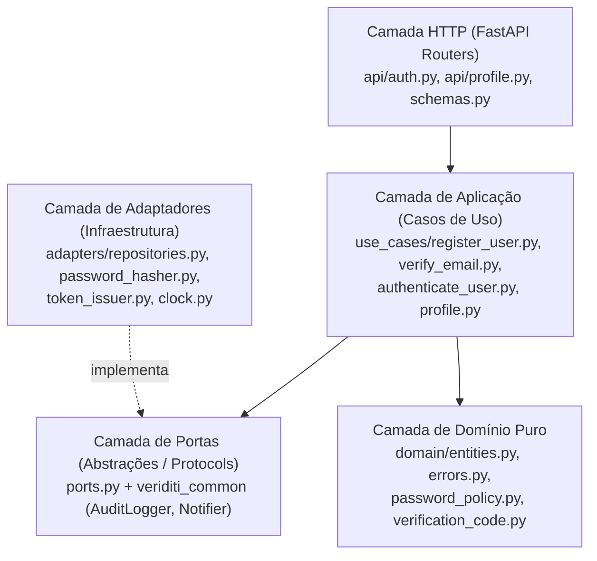

# Princípios SOLID e Alinhamento Arquitetural (SBA) no Veriditi (`services/auth`)

Este documento descreve onde e por que cada um dos cinco princípios **SOLID**, o **PEP 8 (Python Style Guide)** e as boas práticas de Engenharia de Software foram aplicados na implementação do **Serviço de Automação / Autenticação** (`services/auth`, Issues **#7**, **#8**, **#9** e **#10**), integrado à biblioteca compartilhada (`libs/python/common`, Issue **#4** / PR **#53**), em estrita conformidade com a **Arquitetura Baseada em Serviços (Service-Based Architecture — SBA)** do projeto.

---

## 1. Alinhamento com a Arquitetura Baseada em Serviços (SBA)

O Veriditi adota o estilo arquitetural **Service-Based Architecture (SBA) / Arquitetura Baseada em Serviços**, estruturado em torno dos seguintes elementos do documento arquitetural:

### 1.1 Top 4 Características Arquiteturais
1. **Segurança**
2. **Confiabilidade**
3. **Auditabilidade**
4. **Recuperabilidade**

### 1.2 Componentes da Arquitetura (SBA)
- **API Gateway (`API Getaway`)**: ponto único de entrada HTTP para a aplicação Web, responsável pela validação centralizada de JWT e propagação de contexto (`X-Request-ID`, `X-User-Id`, `X-Internal-Token`).
- **Serviço de Automação (Autenticação — `services/auth`)**: componente responsável por gestão de identidade, cadastro (`RF01`), verificação de e-mail (`RF02`), sessão JWT RS256 e rotação de refresh token (`RF03`) e gestão de perfil e senha (`RF06`).
- **Serviço de Pagamento (`services/payment`)**: gestão de pacotes de créditos, checkout PIX e razão contábil (*ledger*).
- **Serviço de Notificações (`services/notification`)**: disparo transacional de e-mails com idempotência e retentativas.
- **Serviço de Captura (`services/capture`)**: automação do isolamento e coleta de provas digitais (screenshots e vídeos de navegação).
- **Serviço de Armazenamento (`services/storage`)**: preservação imutável de evidências com verificação de integridade por hash SHA-256.
- **Serviço de Monitoramento (`services/monitoring`)**: ingestão e preservação append-only de eventos de auditoria e logs operacionais em banco dedicado (`veriditi_logs`).

### 1.3 Táticas Arquiteturais Mapeadas no Código
- **Segurança**:
  - *Verificação de Email*: implementada em [`verify_email.py`](../services/auth/src/auth_service/use_cases/verify_email.py) e [`verification_code.py`](../services/auth/src/auth_service/domain/verification_code.py) com códigos CSPRNG de 6 dígitos e HMAC-SHA256 com *pepper*.
  - *Recuperação de Conta por EMail*: ponto de extensão preparado no domínio e nas portas de notificação/auditoria para a Sprint 2 (`#19`).
  - *Verificação em Duas Etapas*: preparada no resultado polimórfico `LoginResult` ([`entities.py`](../services/auth/src/auth_service/domain/entities.py)) e no enum `VerificationPurpose.MFA` ([`models.py`](../services/auth/src/auth_service/models.py)).
- **Confiabilidade**:
  - *Arquitetura Baseada em Serviços*: isolamento de falhas nos clientes HTTP internos ([`audit.py`](../libs/python/common/src/veriditi_common/audit.py) e [`notifications.py`](../libs/python/common/src/veriditi_common/notifications.py)), garantindo que indisponibilidades temporárias não derrubem o fluxo do usuário.
  - *Divisão do Banco de Dados*: segregação de posse e privilégios mínimos por serviço (`auth_svc` sem `DELETE` em `users`, conforme [`migrations.py`](../libs/python/common/src/veriditi_common/migrations.py) e [`docs/banco-de-dados.md`](banco-de-dados.md)).
- **Recuperabilidade**:
  - *Geração de Logs Estruturados*: logs JSON padronizados via `structlog` com correlação por `request_id` ([`logging.py`](../libs/python/common/src/veriditi_common/logging.py)).
  - *Divisão dos Bancos de Dados*: separação entre o Banco Central (`veriditi`), o Log Storage (`veriditi_logs`) e o Object Storage de evidências.
  - *Arquitetura Baseada em Serviços*: desacoplamento entre componentes de domínio com estados independentes e migrações próprias por serviço (`alembic_version_auth`).
- **Auditabilidade**:
  - *Geração de Logs Estruturados*: emissão sistemática de eventos de auditoria imutáveis (`AuditEvent`) com sanitização automática de dados sensíveis ([`audit.py`](../libs/python/common/src/veriditi_common/audit.py)).

### 1.4 Decisões Arquiteturais Contempladas
- **Aplicação Web** (`apps/web` consumindo o `API Gateway`).
- **Verificação do Email do Usuario** (`POST /auth/verify-email` e `POST /auth/verify-email/resend`, [#8](https://github.com/Jaedsonn/Veredict/issues/8)).
- **Recuperação da Conta Por Link Via Email** (contratos e infraestrutura de notificação/auditoria preparados para a Sprint 2, [#19](https://github.com/Jaedsonn/Veredict/issues/19)).
- **Verificação em Multiplas Etapas** (contrato de login extensível via `MfaRequiredResult` / `MfaSetupRequiredResult` e `purpose = 'mfa'`, [#18](https://github.com/Jaedsonn/Veredict/issues/18)).
- **Divisão dos Bancos de Dados** (isolamento de posse por serviço com `alembic_version_auth` e privilégios restritos por tabela).
- **Confirmação da Integridade das Provas Por Hash** (padrão `HashHex` em `CHAR(64) ascii_bin` compartilhado em `veriditi_common.db_types`).
- **Geração de Logs Estruturados** (`veriditi_common.logging` e `veriditi_common.audit`, [#4](https://github.com/Jaedsonn/Veredict/issues/4)).
- **Pagamento Por Serviço Externo** (isolamento do domínio de autenticação em relação ao componente `Serviço de Pagamento`).

---

## 2. Visão Geral da Estrutura Interna (`Ports & Adapters`)

Dentro da **Arquitetura Baseada em Serviços (SBA)**, o serviço `services/auth` organiza seu código segundo a Arquitetura Limpa / Hexagonal (*Ports & Adapters*), separando responsabilidades em quatro camadas:

---

## 3. Onde e Por Quê cada Princípio SOLID foi Aplicado

### 3.1 SRP — *Single Responsibility Principle* (Princípio da Responsabilidade Única)

> *"Um módulo ou classe deve ter um, e apenas um, motivo para mudar."*

| Onde foi aplicado | Responsabilidade única | Por que foi utilizado (motivação de negócio e arquitetura) |
| :--- | :--- | :--- |
| [`PasswordPolicy`](../services/auth/src/auth_service/domain/password_policy.py) | Validar exclusivamente as regras de complexidade de senha (mínimo de 10 caracteres, ao menos 1 letra e 1 número). | Isola mudanças na política de senha (RF01 / RNF01) do algoritmo de hash e da persistência. Se a regra de complexidade mudar, nem o caso de uso nem o repositório precisam ser alterados. |
| [`Argon2PasswordHasher`](../services/auth/src/auth_service/adapters/password_hasher.py) | Calcular e verificar hashes criptográficos Argon2id, incluindo verificação *dummy* em tempo constante. | Separa os parâmetros criptográficos (`time_cost`, `memory_cost`, `parallelism`) da lógica de login e cadastro, permitindo calibrar segurança/performance em um único ponto. |
| [`VerificationCodeService`](../services/auth/src/auth_service/domain/verification_code.py) | Gerar códigos CSPRNG de 6 dígitos (`secrets.randbelow`), calcular `HMAC-SHA256` com `VERIFICATION_PEPPER` e comparar hashes em tempo constante (`hmac.compare_digest`). | Centraliza a criptografia de códigos de verificação (RF02), garantindo que o código em texto puro nunca vaze para a camada de persistência. |
| [`PyJwtTokenIssuer`](../services/auth/src/auth_service/adapters/token_issuer.py) | Emitir Access Tokens JWT assinados com `RS256` (`sub`, `email`, `iat`, `exp`, `iss`, `aud`, `jti`, `sid`) e gerar/hashear Refresh Tokens opacos de 32 bytes com `SHA-256`. | Isola a biblioteca `PyJWT` e a gestão de chaves assimétricas RSA da lógica de rotação de sessão e detecção de reuso. |
| [`RegisterUser`](../services/auth/src/auth_service/use_cases/register_user.py), [`VerifyEmail`](../services/auth/src/auth_service/use_cases/verify_email.py), [`AuthenticateUser`](../services/auth/src/auth_service/use_cases/authenticate_user.py), [`ChangePassword`](../services/auth/src/auth_service/use_cases/profile.py) | Cada classe representa um único caso de uso de negócio. | Evita uma classe monolítica `AuthService` ("God Object") que misturaria cadastro, OTP, JWT, rotação de refresh token e edição de perfil. |
| [`redact_sensitive`](../libs/python/common/src/veriditi_common/logging.py) / [`AuditEvent`](../libs/python/common/src/veriditi_common/audit.py) | Sanitizar recursivamente logs e metadados removendo chaves sensíveis (`password`, `token`, `code`, `secret`). | Garante em um único ponto que nenhum serviço exponha segredos nos logs ou eventos de auditoria enviados ao `Serviço de Monitoramento`. |

---

### 3.2 OCP — *Open/Closed Principle* (Princípio Aberto/Fechado)

> *"Entidades de software devem estar abertas para extensão, mas fechadas para modificação."*

| Onde foi aplicado | Ponto de extensão | Por que foi utilizado |
| :--- | :--- | :--- |
| [`LoginResult`](../services/auth/src/auth_service/domain/entities.py) (`AuthenticatedResult \| MfaRequiredResult \| MfaSetupRequiredResult`) | Tipo união discriminado retornado por `AuthenticateUser.execute()`. | Na Sprint 1 (#9), o login conclui emitindo `AuthenticatedResult`. Na Sprint 2 (#18 — *Verificação em Duas Etapas / Multiplas Etapas*), o fluxo passa a retornar `MfaRequiredResult` ou `MfaSetupRequiredResult` sem quebrar a assinatura do caso de uso nem modificar os consumidores existentes. |
| [`VerificationPurpose`](../services/auth/src/auth_service/models.py) (`EMAIL_VERIFICATION`, `MFA`) | Coluna `purpose` parametrizada nos métodos de `VerificationCodeRepository`. | Permite reutilizar a mesma estrutura e repositório de códigos de 6 dígitos tanto para confirmação de e-mail (#8) quanto para o segundo fator por e-mail (#18), sem alterar as queries existentes. |
| [`AuditLogger`](../libs/python/common/src/veriditi_common/audit.py) e [`Notifier`](../libs/python/common/src/veriditi_common/notifications.py) | Novos transportes (ex.: Outbox / Redis Streams na Sprint 2, #37) podem ser adicionados criando novas classes que implementam o `Protocol`. | Os casos de uso (`RegisterUser`, `VerifyEmail`, `AuthenticateUser`, `UpdateProfile`, `ChangePassword`) estão **fechados para modificação** quando o transporte evoluir de HTTP *fire-and-forget* para mensageria assíncrona. |

---

### 3.3 LSP — *Liskov Substitution Principle* (Princípio da Substituição de Liskov)

> *"Subtipos devem ser substituíveis por seus tipos base sem alterar a corretude do programa."*

| Abstração (`Protocol`) | Implementação de Produção | Implementação de Teste / Fallback | Garantia de Substituibilidade (LSP) |
| :--- | :--- | :--- | :--- |
| [`AuditLogger`](../libs/python/common/src/veriditi_common/audit.py) | `HttpAuditLogger` (envia `POST /internal/events` ao `Serviço de Monitoramento` com degradação graciosa para log estruturado) | `InMemoryAuditLogger` (acumula eventos em memória nos testes) | Ambas respeitam o pré-requisito de sanitização de `AuditEvent` e o pós-requisito de **nunca lançar exceções de transporte** que interrompam a transação principal do usuário. |
| [`Notifier`](../libs/python/common/src/veriditi_common/notifications.py) | `HttpNotifier` (envia `POST /internal/notifications` ao `Serviço de Notificações`) | `InMemoryNotifier` (captura notificações enviadas para inspeção do código de 6 dígitos nos testes) | Ambas aceitam `NotificationRequest` com `idempotency_key` e completam de forma resiliente, permitindo testar todo o fluxo de verificação de e-mail (#8) sem servidor SMTP externo. |
| [`Clock`](../services/auth/src/auth_service/ports.py) | `SystemClock` ([`clock.py`](../services/auth/src/auth_service/adapters/clock.py)) | `FakeClock` ([`clock.py`](../services/auth/src/auth_service/adapters/clock.py)) | Ambas retornam `datetime` *timezone-aware* em UTC. Substituir `SystemClock` por `FakeClock` permite avançar o tempo (`clock.advance(minutes=16)` ou `seconds=65`) e testar determinísticamente expiração de código (15 min), cooldown de reenvio (60 s) e janela de 1 hora (5 reenvios/h). |

---

### 3.4 ISP — *Interface Segregation Principle* (Princípio da Segregação de Interfaces)

> *"Nenhum cliente deve ser forçado a depender de métodos que não utiliza."*

Em vez de criar um repositório genérico monolítico (`AuthRepository`) ou um único serviço de criptografia, as interfaces em [`ports.py`](../services/auth/src/auth_service/ports.py) foram segregadas por coesão funcional:

- **`UserRepository`**: apenas operações sobre a entidade `User` (`create`, `get_by_id`, `get_by_email`, `mark_email_verified`, `update_name`, `update_password_hash`).
- **`VerificationCodeRepository`**: apenas operações sobre códigos de verificação (`create_and_invalidate_previous`, `get_latest_active`, `get_latest_for_user`, `count_created_since`, `increment_attempts`, `mark_consumed`).
- **`RefreshTokenRepository`**: apenas operações sobre sessões de refresh (`create`, `get_by_hash`, `rotate_token`, `revoke`, `revoke_all_for_user`).
- **`PasswordHasher`** vs. **`TokenIssuer`**: separados para que casos de uso que não emitem JWT (como `RegisterUser` e `VerifyEmail`) não dependam de chaves RSA ou PyJWT, e casos de uso que apenas consultam perfil (`GetProfile`) dependam **exclusivamente** de `UserRepository` ([`profile.py`](../services/auth/src/auth_service/use_cases/profile.py)).

---

### 3.5 DIP — *Dependency Inversion Principle* (Princípio da Inversão de Dependência)

> *"Módulos de alto nível não devem depender de módulos de baixo nível. Ambos devem depender de abstrações."*

1. **Casos de uso desacoplados de frameworks**: Nenhum arquivo em `services/auth/src/auth_service/use_cases/` ou `domain/` importa `fastapi`, `sqlalchemy`, `argon2` ou `jwt`. Todos dependem exclusivamente dos `Protocol`s definidos em [`ports.py`](../services/auth/src/auth_service/ports.py) e `veriditi_common`.
2. **Injeção de Dependências explícita na borda HTTP**: O módulo [`dependencies.py`](../services/auth/src/auth_service/dependencies.py) atua como *Composition Root*, instanciando os adaptadores concretos do auth (`SqlAlchemyUserRepository`, `Argon2PasswordHasher`, `PyJwtTokenIssuer`) e injetando-os nos casos de uso via `Depends` do FastAPI. `BackgroundAuditLogger` ([`audit.py`](../libs/python/common/src/veriditi_common/audit.py)) e `BackgroundNotifier` ([`notifications.py`](../libs/python/common/src/veriditi_common/notifications.py)) são da lib comum: o `dependencies.py` apenas reexporta `get_audit_logger` e `get_notifier`, que os compõem sobre o que está em `app.state`.
3. **Facilidade de teste e substituição**: Nos testes ([`conftest.py`](../services/auth/tests/conftest.py)), `app.state.audit_logger`, `app.state.notifier` e `app.state.clock` são substituídos por implementações em memória sem usar *monkeypatching* invasivo.

---

## 4. Style Guide Python (PEP 8) e Boas Práticas de Engenharia de Software

- **Conformidade com PEP 8 e Tipagem Estrita**:
  - Verificação automatizada com **Ruff** (`select = ["E", "F", "I", "B", "UP", "ASYNC", "SIM"]`, `line-length = 100`) e **Mypy** para checagem estática de tipos em Python 3.12+.
  - Uso de `dataclass(frozen=True, slots=True)` para objetos de valor e comandos imutáveis, reduzindo consumo de memória e prevenindo mutações acidentais.
- **Segurança por Design (*Security by Design*)**:
  - Comparações de segredos em tempo constante via `hmac.compare_digest` (no token interno `X-Internal-Token` e no código de verificação de e-mail).
  - Prevenção de enumeração de contas no login (`verify_dummy` executa Argon2id mesmo quando o e-mail não existe) e no reenvio de código (`POST /auth/verify-email/resend` retorna `202 Accepted` para e-mails inexistentes ou já verificados).
  - Prevenção de *Mass Assignment* em `PATCH /me` (`ProfileUpdate` aceita apenas `name` com `extra="ignore"`, ignorando `email`, `status`, etc.).
  - Detecção de reuso de Refresh Token (*Refresh Token Rotation*): se um token já rotacionado (`revoke_reason = 'rotated'`) for reapresentado, o serviço revoga **todas** as sessões ativas do usuário (`revoke_reason = 'reuse_detected'`) e emite o evento crítico `auth.session.refresh_reuse_detected`.
